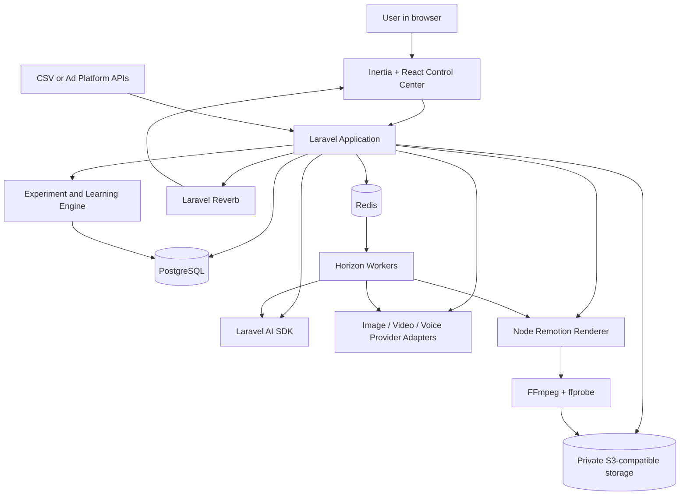
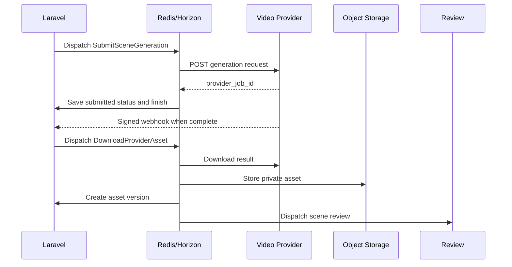

# VideoAuto — Laravel Technical Handoff

**Document status:** Architecture and implementation handoff  
**Project:** Automated production and experimentation system for 15-second dating-app advertisements  
**Primary application framework:** Laravel 13  
**AI integration:** Laravel AI SDK  
**Prepared:** 21 July 2026  
**Intended readers:** Product owner, Laravel developer, frontend developer, AI engineer, media-pipeline developer, and future maintainers

---

## 1. Executive summary

VideoAuto should be built as a **Laravel-controlled creative production system**.

The central architectural rule is:

> **Laravel owns the process, state, budget, versions, approvals, and audit trail. AI models perform bounded creative or analytical tasks inside that process.**

This means VideoAuto is **not** one autonomous agent that receives “make an ad” and improvises everything. It is a normal, reliable web application with a clearly defined pipeline:

1. Store the real product and brand information.
2. Create a campaign brief.
3. Generate several materially different advertising hypotheses.
4. Let a person approve or edit the direction.
5. Convert the direction into a timed 15-second storyboard.
6. Create continuity references and keyframes.
7. Generate short scenes individually.
8. Validate each scene.
9. add voice, captions, music, product UI, and a CTA.
10. Assemble the final ad deterministically.
11. Review and approve it.
12. Publish or export it.
13. Import campaign results.
14. Convert those results into evidence-based learnings for the next campaign.

Every important object is versioned. The system must always be able to answer:

- Which brand profile was used?
- Which brief version generated this concept?
- Which prompt and model generated the storyboard?
- Which keyframe generated this scene?
- How many attempts did the scene require?
- Which exact scene versions were used in the final render?
- What did the final render cost?
- Which version was published?
- Which campaign metrics belong to that published version?
- What conclusion was learned, and what evidence supports it?

The first product should be a **standalone Laravel control center**, available at a separate URL such as:

```text
https://ads.example.com
```

The domain logic should be organized so it can later be extracted into reusable Composer packages. Other Laravel applications can integrate through a small client package, API, signed links, or SSO rather than installing the entire generation infrastructure into every project.

---

## 2. Product vision

VideoAuto helps a person move from a real product and a marketing objective to several measurable 15-second advertisements without manually coordinating copywriters, image tools, video tools, voice tools, editors, and spreadsheets.

The product is specifically intended to create short advertisements that:

- Begin with a recognizable human moment.
- Create an immediate emotional connection.
- Tell a simple micro-story.
- Demonstrate a real product mechanism.
- Make sense without making the viewer work to understand it.
- End with a clear, appropriate action.
- Can be tested as a defined hypothesis.
- Can be traced to real campaign performance.

For dating apps, the preferred emotional structure is:

```text
Recognizable moment
→ mild tension or friction
→ product-specific change
→ believable emotional payoff
→ clear invitation
```

Example:

```text
Every conversation begins with the same generic opener
→ the user feels bored
→ the app introduces a meaningful conversation prompt
→ two people have a genuinely playful exchange
→ “Start with something real”
```

The source advertising transcript contains useful principles: identify the audience’s current emotional experience, use stories where possible, combine problem and solution, include a direct action, and test several emotional approaches. It should be treated as a **creative heuristic library**, not as unquestionable psychology. VideoAuto should preserve the useful idea of finding specific, recognizable human moments while rejecting manipulative or unsupported rules such as “negative emotions are always ten times stronger.”

---

## 3. What the system is—and what it is not

### 3.1 The system is

- A multi-tenant web application.
- A structured campaign workflow.
- A creative hypothesis generator.
- A media-generation orchestrator.
- A deterministic video assembly system.
- A versioned creative repository.
- A review and approval tool.
- A cost ledger.
- An experimentation and learning system.
- A provider-agnostic integration layer.

### 3.2 The system is not

- A single giant prompt.
- A fully autonomous ad publisher in the first release.
- A substitute for product truth or legal approval.
- A system that invents product features or performance claims.
- A system that infers sensitive personal vulnerabilities.
- A system that overwrites previous creative work.
- A graphical video editor controlled continuously by an LLM.
- A system that optimizes only for clicks.
- A library of arbitrary images collected from search engines.

---

## 4. Main architectural decision

Use a **modular Laravel monolith** plus one independent rendering service.

```text
Laravel control center
├── Web UI
├── API
├── Authentication and workspaces
├── Campaign workflow
├── Versioning and lineage
├── Laravel AI SDK agents
├── Provider adapters
├── Queue jobs
├── Reviews and approvals
├── Cost ledger
└── Experiment analytics

Node rendering service
├── Remotion
├── FFmpeg
├── ffprobe
└── Render templates
```

Do not begin with microservices. Most complexity belongs together in Laravel because the same transactions, permissions, versions, and workflow rules affect the whole campaign.

The rendering service is separate because Remotion is a Node.js tool and video rendering is resource-intensive. Video-generation APIs remain external providers behind Laravel contracts.

---

## 5. Recommended technology stack

| Layer | Technology | Responsibility |
|---|---|---|
| Backend framework | Laravel 13, PHP 8.3+ | Business logic, API, workflow, authorization |
| AI abstraction | Laravel AI SDK | Structured agents, tools, images, TTS, STT, embeddings |
| Frontend | Inertia 3, React 19, TypeScript | Interactive production dashboard |
| UI | Tailwind 4, shadcn/ui | Reusable interface components |
| Database | PostgreSQL | Transactional data, versions, experiments, audit trail |
| Flexible data | PostgreSQL JSONB | Briefs, concepts, storyboards, review payloads |
| Semantic retrieval later | PostgreSQL + pgvector | Retrieve relevant previous learnings and examples |
| Queue broker | Redis | Background job transport, locks, cache |
| Queue dashboard | Laravel Horizon | Queue throughput, failures, retries, balancing |
| Real-time UI | Laravel Reverb | Job progress, render updates, approval notifications |
| Object storage | S3-compatible private storage | Images, videos, audio, frames, manifests |
| Local object storage | MinIO | Local-development equivalent of S3 |
| Renderer | Node.js + Remotion | Data-driven captions, layouts, transitions, end cards |
| Media tooling | FFmpeg and ffprobe | Cutting, encoding, probing, extracting frames/audio |
| Local diagnostics | Laravel Telescope | Requests, queries, jobs, exceptions |
| Production monitoring | Laravel Pulse plus an error tracker | Application and queue health |
| Authentication | Laravel starter-kit auth; Sanctum for API | Users, sessions, API clients |
| Testing | Pest/PHPUnit, Laravel AI fakes, Vitest, Playwright | Unit, integration, UI, and workflow testing |
| Local environment | Docker Compose | Reproducible application stack |
| CI/CD | GitHub Actions | Tests, static analysis, builds, deployment |
| Deployment | Laravel Cloud, Forge, or Docker VPS | Production runtime |

### 5.1 Initial AI model routing

Model names must live in configuration, never in business logic. A sensible initial routing policy as of July 2026 is:

| Task | Initial model tier | Reason |
|---|---|---|
| Intake cleanup and extraction | GPT-5.6 Luna | High-volume, lower-cost structured work |
| Tagging and classification | GPT-5.6 Luna | Routine and repeatable |
| Campaign brief | GPT-5.6 Terra | Balance of reasoning and cost |
| Creative hypotheses | GPT-5.6 Terra | Strong reasoning without always using frontier cost |
| Script and storyboard | GPT-5.6 Terra | Complex structure and emotional coherence |
| Difficult final review | GPT-5.6 Terra or Sol | Strong multimodal reasoning |
| Rare campaign investigation | GPT-5.6 Sol | Highest-capability analysis |
| Image generation | Provider benchmark winner | Do not assume one model is permanently best |
| Video generation | Seedance 2.0 Fast initially | Low-cost scene generation; provider adapter required |
| Voice | ElevenLabs or OpenAI through Laravel AI SDK | Configurable by campaign |
| Transcription | OpenAI STT through Laravel AI SDK | Reference-ad analysis and caption alignment |

The system must run an internal benchmark before declaring a default image provider. Test face realism, expression, identity continuity, prompt adherence, cost, latency, and acceptance rate.

---

## 6. High-level architecture



---

## 7. Human user journey

A normal user should experience the system like this:

1. **Create a brand.**  
   Enter the dating app’s real features, target market, tone, assets, allowed claims, and forbidden claims.

2. **Create a campaign.**  
   Select the objective, audience, platform, CTA, budget, number of variants, and emotional territory.

3. **Review five ideas.**  
   VideoAuto proposes five genuinely different advertising hypotheses and explains what each one tests.

4. **Approve one or more ideas.**  
   The user can edit, reject, duplicate, or approve.

5. **Review a timed storyboard.**  
   The system shows every one-to-three-second shot, its purpose, copy, action, emotion, and requirement coverage.

6. **Generate visual references.**  
   Approve the people, locations, wardrobe, product UI, and keyframes before spending money on video.

7. **Generate scenes.**  
   The system creates short scenes in parallel and displays progress.

8. **Fix only what failed.**  
   A malformed two-second scene is regenerated without rebuilding the full ad.

9. **Compare final variants.**  
   Watch versions side by side, inspect costs and validation results, and approve the chosen outputs.

10. **Export or publish.**  
    Initially, download the videos and campaign package. Direct platform publishing comes later.

11. **Import performance.**  
    Upload a campaign CSV or connect an advertising account.

12. **Review learnings.**  
    See which hook, emotional transition, format, product mechanism, or CTA performed better—and how confident that conclusion is.

---

## 8. Core design principles

### 8.1 Laravel owns state

An AI model never directly decides that a campaign is approved, published, or complete. Laravel validates every transition.

### 8.2 AI outputs are structured

Important AI outputs must follow schemas, not free-form prose.

### 8.3 Creative objects are immutable once versioned

Editing a brief, concept, storyboard, shot, or render creates a new version.

### 8.4 Retries and creative revisions are different

- **Retry:** same requested input, another generation attempt.
- **Revision:** the intended creative input changed, so create a new version.

### 8.5 Generate from cheap to expensive

```text
Text concept
→ storyboard
→ still keyframe
→ short scene
→ final render
```

Do not spend video-generation money before the direction is approved.

### 8.6 Humans approve important gates

At minimum:

- Brief approval.
- Concept approval.
- Storyboard approval.
- Final publishing approval.

### 8.7 The app learns from evidence, not model opinion

AI scores help with quality control. Real campaign performance is the commercial ground truth.

### 8.8 Every external provider is replaceable

The domain layer depends on contracts, not Seedance-, OpenAI-, Gemini-, or ElevenLabs-specific code.

### 8.9 Product truth is explicit

The app may only show or claim features contained in the approved product profile.

### 8.10 Safety and compliance are pipeline stages

Policy review is not a sentence hidden in a prompt.

---

## 9. Domain vocabulary

| Term | Meaning |
|---|---|
| Workspace | A tenant containing users, brands, campaigns, assets, and billing |
| Brand | The dating product or client |
| Brand Profile | Versioned source of truth about the brand and product |
| Campaign | A business objective and experiment container |
| Brief | Approved requirements for a campaign |
| Requirement | A traceable must-have or must-not-have condition |
| Creative Hypothesis | A testable ad idea, not yet media |
| Creative Genome | Structured description of the variables in an ad |
| Concept | Human-readable presentation of a creative hypothesis |
| Storyboard | Timed shot plan |
| Shot | One planned visual unit |
| Continuity Package | Approved references for people, places, wardrobe, UI, and look |
| Keyframe | Approved still image used to guide a scene |
| Scene | A generated short video clip |
| Generation Attempt | One provider request for a defined input version |
| Render Manifest | Exact data used to assemble a final video |
| Render | A generated final or preview video |
| Review | Technical, creative, or policy evaluation |
| Variant | A campaign-ready ad that tests defined variables |
| Published Creative | A variant mapped to an external platform ID |
| Metric Observation | Raw performance data for a published creative |
| Learning | A conclusion linked to evidence and limitations |
| Artifact | Any versioned creative object |
| Artifact Version | Immutable snapshot of an artifact |
| Lineage | The graph explaining what produced what |

---

# Part I — End-to-end pipeline

## 10. Phase 0: Workspace and project bootstrap

### User action

The owner creates a workspace and invites collaborators.

### Laravel responsibilities

- Create the workspace.
- Assign roles.
- Create workspace settings.
- Create default provider profiles.
- Create default policy profiles.
- Create a cost budget.
- Create private storage prefixes.
- Record audit events.

### Suggested roles

```text
owner
administrator
strategist
editor
reviewer
analyst
viewer
```

### Output

```text
Workspace WSP-001
```

### Gate

No campaign can access another workspace’s data or media.

---

## 11. Phase 1: Brand and product truth

This is the permanent foundation. The system should not generate campaigns from a vague paragraph alone.

### User supplies

- Brand name.
- Product description.
- Markets and languages.
- Real product features.
- Differentiators.
- Intended users.
- Brand tone.
- CTA options.
- Approved claims.
- Claims requiring evidence.
- Prohibited claims.
- Safety features.
- Existing visual identity.
- Logos, fonts, colors, screenshots, and product captures.
- Licensed actors, voices, music, and media.
- Platform accounts and certifications.

### AI responsibility

The `BrandProfileAgent` helps convert conversational input into a complete structured profile and flags missing information.

### Laravel responsibility

- Validate the structured output.
- Require evidence for factual claims.
- Save an immutable brand-profile version.
- Link uploaded evidence and assets.
- Prevent an agent from silently inventing missing values.

### Example output

```json
{
  "brand_name": "Example",
  "markets": ["DE"],
  "languages": ["de", "en"],
  "tone": ["warm", "honest", "playful"],
  "approved_features": [
    {
      "id": "FEAT-001",
      "name": "Voice prompts",
      "evidence_asset_ids": ["AST-102"]
    }
  ],
  "approved_claims": [],
  "prohibited_claims": [
    "Guaranteed relationship",
    "Perfect compatibility",
    "Everyone finds a match"
  ],
  "cta_options": [
    "Start with something real",
    "Try Example"
  ]
}
```

### Version output

```text
Brand Profile BP-001 v1
```

### Gate

A campaign cannot use a feature or claim that is absent from an approved brand-profile version.

---

## 12. Phase 2: Optional reference-ad ingestion

The user may upload an existing advertisement to study its structure.

### Processing pipeline

```text
Upload
→ malware/type/size validation
→ private object storage
→ ffprobe metadata extraction
→ FFmpeg audio extraction
→ transcription
→ scene/cut detection
→ sampled frames and contact sheet
→ OCR or model reading of on-screen text
→ multimodal analysis
→ reconstructed creative genome
```

### Important technical point

Text models do not need to receive an entire raw video. Laravel should prepare:

- Transcript.
- Shot timings.
- Selected frames.
- Audio cues.
- On-screen text.
- Technical metadata.

Then the `ReferenceAdAnalysisAgent` analyzes this package.

### Output

```json
{
  "hook": "Several chats open with the same generic message",
  "emotion_from": "sameness",
  "emotion_to": "curiosity",
  "product_mechanism": "conversation prompts",
  "story_pattern": "friction-mechanism-reaction",
  "shots": 6,
  "cta": "Start with something real",
  "uncertainties": [
    "The product feature cannot be verified from the uploaded video alone"
  ]
}
```

### Security rule

Uploaded copy and transcripts are **untrusted data**, not instructions. They must never override system prompts or workflow rules.

### Gate

A reconstructed brief remains a draft until a human confirms it.

---

## 13. Phase 3: Campaign creation and brief

### User selects

- Brand-profile version.
- Campaign objective.
- Target market.
- Approved audience segment.
- Platform and placement.
- Primary KPI.
- Product feature to demonstrate.
- Emotional territory.
- Offer.
- CTA.
- Budget.
- Number of variants.
- Required and forbidden elements.
- Output languages and formats.

### AI responsibility

The `CampaignBriefAgent` turns the selections into a complete brief, highlights contradictions, and proposes missing decisions.

### Laravel responsibility

- Validate against the approved brand profile.
- Create traceable requirements.
- Estimate cost.
- Ask for approval.
- Lock the approved version.

### Requirement examples

```text
REQ-001: Establish a recognizable situation in the first 1.5 seconds.
REQ-002: Show the approved voice-prompt feature before second 8.
REQ-003: Do not portray being single as personal failure.
REQ-004: Show only clearly adult actors.
REQ-005: Use the approved CTA.
REQ-006: Final duration must be 15 seconds or less.
REQ-007: Deliver a 9:16 master.
```

### Output

```text
Campaign CMP-018
Campaign Brief BRF-018 v1
```

### Gate

The system does not generate concepts until the brief is approved.

---

## 14. Phase 4: Creative hypothesis generation

The system should create several **different strategic ideas**, not five visual variations of one idea.

### AI responsibility

The `CreativeStrategyAgent` receives:

- Approved brief version.
- Approved brand-profile version.
- Relevant supported learnings.
- Selected examples.
- Platform constraints.
- Policy constraints.

It returns a structured set of hypotheses.

### Example hypotheses

```text
A. Conversation sameness → curiosity
B. First-message awkwardness → playfulness
C. Superficial profiles → recognition
D. Pre-date uncertainty → control
E. Dating effort → ease
```

### Creative genome

Every hypothesis stores:

```json
{
  "trigger_moment": "Several conversations begin with generic openers",
  "emotion_from": "sameness",
  "emotion_to": "curiosity",
  "product_mechanism": "voice prompts",
  "hook_type": "recognizable micro-moment",
  "story_pattern": "friction-mechanism-reaction",
  "visual_format": "UGC narrative with product inserts",
  "pace": "fast opening, warmer payoff",
  "cta": "Start with something real",
  "primary_test_variable": "hook situation",
  "policy_risk": "low",
  "production_difficulty": 2
}
```

### Automatic checks

- Concepts are materially distinct.
- Every concept uses a real product feature.
- No prohibited claim appears.
- The story fits 15 seconds.
- The hook is understandable visually.
- The number of people and locations fits the budget.
- Dating-ad personal-attribute rules are respected.

### Output

```text
Concept CON-044 v1
Concept CON-045 v1
Concept CON-046 v1
Concept CON-047 v1
Concept CON-048 v1
```

### Gate

A person approves, edits, rejects, or duplicates each concept.

---

## 15. Phase 5: Concept approval and branching

The concept board shows:

- Hook.
- Audience moment.
- Emotional transition.
- Product mechanism.
- Story summary.
- What the concept tests.
- Estimated production cost.
- Policy risk.
- Production difficulty.
- AI review.
- Human notes.

### User actions

```text
approve
reject
edit
duplicate
request alternatives
```

### Version behavior

Editing `CON-044 v1` produces `CON-044 v2`. Duplicating it produces a new stable concept ID whose first version points to the original as its source.

### Gate

Only explicitly approved concept versions can generate storyboards.

---

## 16. Phase 6: Script and storyboard

### AI responsibilities

The `CopyAgent` proposes concise voiceover, dialogue, captions, and CTA copy.

The `StoryboardAgent` converts the approved concept into timed shots.

### Fifteen-second target structure

| Time | Function |
|---|---|
| 0.0–1.5s | Recognizable hook |
| 1.5–4.0s | Friction |
| 4.0–8.0s | Product mechanism |
| 8.0–12.0s | Human payoff |
| 12.0–15.0s | Brand and CTA |

This is a guideline, not a hard template. The total duration is a hard constraint.

### Shot schema

```json
{
  "shot_number": 2,
  "start_ms": 1400,
  "duration_ms": 2100,
  "purpose": "Establish repetitive-conversation friction",
  "subject_id": "CHAR-001",
  "location_id": "LOC-001",
  "framing": "over-shoulder medium close-up",
  "action": "The thumb pauses over a generic reply and deletes it",
  "emotion_from": "neutral",
  "emotion_to": "mild frustration",
  "on_screen_text": "When every chat starts the same...",
  "voiceover": null,
  "audio_cue": "three restrained message sounds",
  "requirement_ids": ["REQ-001"],
  "continuity_from_shot": 1,
  "continuity_to_shot": 3
}
```

### Laravel validation

- Total duration does not exceed placement limit.
- All mandatory requirements are covered.
- Spoken copy fits the available time.
- CTA is visible long enough.
- Product mechanism is visually represented.
- Shot order is coherent.
- Actors and locations do not exceed budget.
- No unsupported product UI is requested.
- Each shot has a clear purpose.

### Output

```text
Script SCR-044 v1
Storyboard SB-044 v1
Shots SH-001 ... SH-006
```

### Gate

Human storyboard approval.

---

## 17. Phase 7: Continuity package

Before video generation, create reusable references.

### Continuity entities

- Character.
- Age confirmation.
- Face and hairstyle.
- Wardrobe.
- Location.
- Time of day.
- Lighting.
- Camera language.
- Phone/device.
- Product UI.
- Color treatment.
- Expression references.
- Voice identity, when applicable.

### Example IDs

```text
CHAR-001
WARD-003
LOC-002
DEVICE-001
UI-004
LOOK-002
VOICE-001
```

### Why this is required

Without a continuity package, each scene prompt independently reinvents the actor, wardrobe, room, phone, and app. The result becomes visibly inconsistent.

### Product UI rule

Real application UI should come from:

- Approved screenshots.
- Deterministic HTML/React recreations.
- Approved motion templates.

Do not ask a generative video model to invent readable product screens.

### Output

```text
Continuity Package CONT-044 v1
```

### Gate

Continuity references must be approved before scene generation.

---

## 18. Phase 8: Keyframe generation

### Process

```text
Approved shot version
+ continuity references
+ visual style
→ image prompt
→ several image candidates
→ technical and multimodal review
→ human selection
→ approved keyframe version
```

### Laravel responsibilities

- Create one generation request per candidate.
- Reserve budget.
- Store provider settings.
- Download outputs into private storage.
- Calculate SHA-256.
- Create thumbnails.
- Record attempts separately.
- Attach review results.
- Mark the chosen keyframe.

### Generation attempt example

```text
Shot SH-003 v2
├── Attempt 1: rejected — expression incorrect
├── Attempt 2: rejected — actor identity drift
└── Attempt 3: approved — Keyframe KF-003 v1
```

### Gate

Only approved keyframes may become default scene inputs.

---

## 19. Phase 9: Short-scene video generation

Generate each scene separately, usually one to three seconds.

### Input

- Approved shot version.
- Approved keyframe.
- Optional ending keyframe.
- Continuity package.
- Movement description.
- Camera description.
- Negative constraints.
- Duration and aspect ratio.
- Provider-specific settings.

### Provider flow

```text
Laravel creates request
→ queue submits provider job
→ provider returns job ID
→ Laravel worker finishes
→ provider webhook or scheduled poll
→ result is downloaded
→ result is stored privately
→ scene review begins
```

A worker must never stay open waiting several minutes for a provider.

### Parallelization

Shots can be submitted as a Laravel job batch:

```text
Generate shot 1
Generate shot 2
Generate shot 3
Generate shot 4
Generate shot 5
Generate shot 6
```

After the batch reaches a usable completion state, Laravel starts scene review.

### Idempotency

Each provider submission has an idempotency key based on:

```text
shot_version
keyframe_version
provider_profile
generation_settings
attempt_number
```

### Output

```text
Scene SC-001 v1
Scene SC-002 v1
...
```

---

## 20. Phase 10: Scene validation

Every scene receives deterministic and multimodal validation.

### Deterministic checks

Use FFmpeg/ffprobe to verify:

- Decodable file.
- Expected duration.
- Expected dimensions.
- Valid frame rate.
- Valid codec.
- Video stream exists.
- No zero-byte or near-empty file.
- No fully black or frozen output beyond threshold.
- Orientation is correct.
- Audio presence matches expectation.
- File checksum and metadata are stored.

### Multimodal checks

The `SceneReviewAgent` receives sampled frames plus the shot definition and checks:

- Actor identity.
- Wardrobe and location continuity.
- Intended action.
- Expression.
- Emotional readability.
- Camera framing.
- Prompt compliance.
- Product/UI correctness.
- Visual artifacts.
- Policy risk.
- Requirement coverage.

### Structured result

```json
{
  "decision": "reject",
  "scores": {
    "brief_adherence": 91,
    "identity_consistency": 48,
    "emotional_readability": 76,
    "technical_quality": 84
  },
  "findings": [
    {
      "code": "IDENTITY_DRIFT",
      "severity": "high",
      "message": "The actor's hairstyle changes substantially."
    },
    {
      "code": "MALFORMED_UI",
      "severity": "high",
      "message": "The phone screen is not usable as product evidence."
    }
  ],
  "recommended_action": "regenerate_same_shot"
}
```

### Retry policy

- Retry provider failures automatically within limits.
- Do not automatically retry creative failures indefinitely.
- Stop when the campaign or shot retry budget is exhausted.
- Escalate repeated failures to human review.
- Regenerate only the failed scene.

### Gate

Only approved scene versions can enter a render manifest.

---

## 21. Phase 11: Voice, captions, music, and sound

### Voice workflow

```text
Approved script
→ draft voice
→ timing check
→ final voice generation or recorded voice
→ transcript alignment
→ word-level caption timing
```

Use a cheaper or temporary voice during draft renders. Generate final-quality voice only after the story and timing are stable.

### Music and sound

MVP sources should be:

- Client-owned.
- Properly licensed.
- From an approved internal library.
- Generated with documented commercial rights.

Store licensing evidence with the audio asset.

### Audio metadata

```text
provider
model
voice ID
settings
script version
language
duration
rights record
cost
```

### Captions

Captions should be generated as structured timed tokens, then rendered deterministically. Do not burn captions into generated scenes.

---

## 22. Phase 12: Deterministic final assembly

The LLM does not control a video editor visually. It produces or validates a render plan; code executes it.

### Laravel output: render manifest

```json
{
  "composition": "dating-story-v1",
  "canvas": {
    "width": 1080,
    "height": 1920,
    "fps": 30
  },
  "duration_frames": 450,
  "shots": [
    {
      "scene_version_id": "SCV-001",
      "from_frame": 0,
      "duration_frames": 42,
      "crop": "cover",
      "position": "center"
    }
  ],
  "captions": [],
  "overlays": [],
  "audio": {
    "voice_asset_version_id": "AUDV-010",
    "music_asset_version_id": "AUDV-011",
    "ducking_db": -7
  },
  "cta": {
    "text": "Start with something real",
    "from_frame": 375,
    "logo_asset_version_id": "ASTV-090"
  }
}
```

### Renderer process

```text
Laravel signs manifest
→ internal request to renderer
→ renderer validates JSON schema
→ renderer obtains temporary storage URLs
→ Remotion renders composition
→ FFmpeg encodes delivery file
→ ffprobe validates output
→ renderer uploads result
→ renderer sends signed callback
→ Laravel creates render version
```

### Outputs

- Low-resolution preview.
- Final master.
- Thumbnail.
- Contact sheet.
- Sampled QA frames.
- Render logs.
- ffprobe metadata.

### Why Remotion and FFmpeg

Remotion is suited to reusable React-based layouts, captions, interface inserts, and end cards driven by JSON input. FFmpeg remains the reliable mechanical tool for media conversion, extraction, filtering, and final validation.

### Version behavior

Changing only the CTA or caption timing creates a new render version without regenerating scenes.

---

## 23. Phase 13: Final validation and approval

### Technical validation

- Duration.
- Resolution.
- Aspect ratio.
- Codec.
- Audio loudness.
- Caption safe zones.
- CTA duration.
- Logo readability.
- No missing media.
- No unexpected black frames.
- File size.

### Creative validation

- Hook is understandable immediately.
- Story is clear.
- Emotional transition is visible.
- Product mechanism is real and understandable.
- CTA follows naturally.
- The ad matches the approved brief.
- The result does not feel like disconnected AI clips.

### Policy validation

- No personal-attribute assertion.
- No negative portrayal of single life.
- No minors or ambiguously young actors.
- No prohibited dating content.
- No deceptive claim.
- Required platform certification is recorded.
- Required AI-content provenance or disclosure is handled.
- Rights are present for likeness, voice, music, and source assets.

### Possible statuses

```text
passed
failed_technical
failed_creative
failed_policy
human_review_required
approved
```

### Gate

Only approved render versions may be exported or mapped to a published creative.

---

## 24. Phase 14: Export and publishing

### MVP export

- Download MP4.
- Download campaign package.
- Export captions.
- Export ad copy.
- Export platform metadata.
- Export a CSV containing variant IDs.
- Produce a manifest with rights and provenance.

### Later publishing integrations

- Meta Ads.
- TikTok Ads.
- Google Ads.
- Other platforms.

Direct publishing should be delayed until the generation and approval workflow is reliable. Publishing APIs introduce permissions, account certification, rate limits, attribution, and platform-specific failures.

### Required mapping

```text
internal campaign ID
internal variant ID
render version ID
platform
external campaign ID
external ad-group ID
external creative ID
external ad ID
publication timestamp
```

---

## 25. Phase 15: Campaign metrics

Start with CSV import. Add platform APIs later.

### Raw observations

```text
impressions
one-second views
three-second views
25% completion
50% completion
75% completion
100% completion
clicks
installs
registrations
completed profiles
first messages
reciprocal conversations
subscriptions
revenue
spend
hides
reports
blocks
uninstalls
```

### Normalized metrics

```text
hook hold rate
three-second hold rate
completion rate
CTR
cost per click
cost per install
cost per completed profile
cost per reciprocal conversation
conversion rate
revenue per acquired user
negative-feedback rate
```

### Dating-app optimization principle

Do not optimize only for click-through rate. A manipulative hook can attract clicks while harming trust, activation, conversation quality, retention, or revenue.

The primary KPI should be configured per campaign and should preferably represent downstream value.

---

## 26. Phase 16: Evidence-based learning

The `LearningAgent` compares structured creative genomes with campaign results.

### Example learning

```json
{
  "status": "supported",
  "scope": {
    "brand_id": "BRD-001",
    "audience_segment_id": "AUD-003",
    "platform": "tiktok",
    "market": "DE"
  },
  "observation": "Conversation-sameness hooks produced stronger early retention than generic romantic montage openings.",
  "evidence": {
    "variant_ids": ["VAR-A", "VAR-C"],
    "metric": "three_second_hold_rate",
    "difference_percent": 19.4,
    "sample_size": 182000
  },
  "limitations": [
    "Actor presentation was not identical.",
    "Evidence comes from one campaign."
  ]
}
```

### Learning statuses

```text
hypothesis
supported
rejected
inconclusive
superseded
```

### Retrieval rule

Future agents receive relevant, scoped, supported learnings. They should not receive every note from every campaign.

### Gate

A learning cannot be promoted from `hypothesis` to `supported` without linked evidence and minimum-data rules.

---

# Part II — Laravel implementation

## 27. Laravel application structure

A practical initial folder structure:

```text
app/
├── Ai/
│   ├── Agents/
│   ├── Middleware/
│   ├── Schemas/
│   └── Tools/
├── Domain/
│   ├── Workspaces/
│   ├── Brands/
│   ├── Campaigns/
│   ├── Creative/
│   ├── Media/
│   ├── Rendering/
│   ├── Reviews/
│   ├── Experiments/
│   ├── Learnings/
│   ├── Compliance/
│   └── Usage/
├── Infrastructure/
│   ├── Providers/
│   ├── Storage/
│   ├── Rendering/
│   ├── Analytics/
│   └── Webhooks/
├── Jobs/
├── Events/
├── Listeners/
├── Http/
│   ├── Controllers/
│   ├── Requests/
│   ├── Resources/
│   └── Middleware/
├── Models/
├── Policies/
└── Support/
```

The goal is understandable boundaries, not ceremonial enterprise architecture. Domain services should hold business rules; controllers should remain thin.

---

## 28. Repository structure

Recommended monorepo:

```text
videoauto/
├── apps/
│   └── control-center/          # Laravel application
├── services/
│   └── renderer/                # Node + Remotion + FFmpeg
├── packages/
│   ├── videoauto-core/          # Later extraction of domain contracts/services
│   └── videoauto-client/        # Client for other Laravel applications
├── docs/
│   ├── architecture/
│   ├── decisions/
│   ├── schemas/
│   └── prompts/
├── infrastructure/
│   ├── docker/
│   ├── nginx/
│   └── deployment/
└── .github/
    └── workflows/
```

### Recommended development sequence

Build the logic inside the control-center application first. Extract stable boundaries into packages once the real workflow is proven. Premature package extraction slows iteration.

---

## 29. Standalone and integration modes

### 29.1 Recommended first mode: standalone

```text
https://ads.example.com
```

Benefits:

- One place for provider credentials.
- One queue system.
- One media store.
- One renderer.
- One analytics database.
- Easier upgrades.
- Easier cost control.
- Easier multi-client use.

### 29.2 Integration with another Laravel application

Install a small package:

```text
videoauto/client
```

It can provide:

- API client.
- Signed deep links.
- Webhook verification.
- Laravel events.
- Optional SSO handoff.
- Typed request/response DTOs.

Example:

```php
$campaign = VideoAuto::campaigns()->create([
    'brand_id' => $brandId,
    'objective' => 'completed_profile',
    'variants' => 5,
]);

return VideoAuto::signedControlCenterUrl($campaign);
```

### 29.3 Embedded mode later

A fuller package may register:

```text
/videoauto
```

or a configured subdomain. This should come after the standalone workflow is stable.

---

## 30. Laravel AI SDK usage

The Laravel AI SDK should be used for:

- Structured text agents.
- Tool calling where needed.
- Image generation where supported.
- Voice generation.
- Transcription.
- Embeddings.
- Provider failover.
- Agent fakes in tests.
- Events for usage logging.

Do not rely on agent conversation storage as the campaign’s canonical state. Campaign state belongs in domain tables and immutable artifacts.

### 30.1 Example structured agent

```php
<?php

namespace App\Ai\Agents;

use Illuminate\Contracts\JsonSchema\JsonSchema;
use Laravel\Ai\Attributes\MaxSteps;
use Laravel\Ai\Attributes\MaxTokens;
use Laravel\Ai\Attributes\Model;
use Laravel\Ai\Attributes\Provider;
use Laravel\Ai\Attributes\Temperature;
use Laravel\Ai\Contracts\Agent;
use Laravel\Ai\Contracts\HasStructuredOutput;
use Laravel\Ai\Enums\Lab;
use Laravel\Ai\Promptable;
use Stringable;

#[Provider(Lab::OpenAI)]
#[Model('gpt-5.6-terra')]
#[MaxSteps(4)]
#[MaxTokens(8000)]
#[Temperature(0.6)]
final class CreativeStrategyAgent implements Agent, HasStructuredOutput
{
    use Promptable;

    public function __construct(
        private readonly array $brief,
        private readonly array $brandProfile,
        private readonly array $relevantLearnings,
    ) {}

    public function instructions(): Stringable|string
    {
        return view('ai.prompts.creative-strategy', [
            'brief' => $this->brief,
            'brandProfile' => $this->brandProfile,
            'relevantLearnings' => $this->relevantLearnings,
        ])->render();
    }

    public function schema(JsonSchema $schema): array
    {
        return [
            'concepts' => $schema->array()
                ->items(
                    $schema->object(fn (JsonSchema $schema) => [
                        'title' => $schema->string()->required(),
                        'trigger_moment' => $schema->string()->required(),
                        'emotion_from' => $schema->string()->required(),
                        'emotion_to' => $schema->string()->required(),
                        'product_mechanism' => $schema->string()->required(),
                        'hook' => $schema->string()->required(),
                        'story_pattern' => $schema->string()->required(),
                        'primary_test_variable' => $schema->string()->required(),
                        'policy_risk' => $schema->string()
                            ->enum(['low', 'medium', 'high'])
                            ->required(),
                    ])
                )
                ->min(5)
                ->max(5)
                ->required(),
        ];
    }
}
```

### 30.2 Explicit orchestration

Prefer:

```php
$conceptResponse = (new CreativeStrategyAgent(
    brief: $briefVersion->payload,
    brandProfile: $brandProfileVersion->payload,
    relevantLearnings: $learnings,
))->prompt('Generate five materially different hypotheses.');

$conceptVersions = $conceptWriter->persist(
    campaign: $campaign,
    briefVersion: $briefVersion,
    response: $conceptResponse,
);
```

Avoid allowing a general agent to decide the complete workflow.

### 30.3 Model routing configuration

```php
return [
    'profiles' => [
        'intake' => [
            'provider' => 'openai',
            'model' => env('VIDEOAUTO_INTAKE_MODEL', 'gpt-5.6-luna'),
        ],
        'strategy' => [
            'provider' => 'openai',
            'model' => env('VIDEOAUTO_STRATEGY_MODEL', 'gpt-5.6-terra'),
        ],
        'review' => [
            'provider' => 'openai',
            'model' => env('VIDEOAUTO_REVIEW_MODEL', 'gpt-5.6-terra'),
        ],
        'investigation' => [
            'provider' => 'openai',
            'model' => env('VIDEOAUTO_INVESTIGATION_MODEL', 'gpt-5.6-sol'),
        ],
    ],
];
```

If PHP attributes make environment-specific routing awkward, construct provider/model arguments through an application service instead. The key rule is configurability and run logging.

---

## 31. Specialized agent catalog

| Agent | Responsibility | Typical model tier |
|---|---|---|
| BrandProfileAgent | Convert intake into product truth | Luna/Terra |
| ReferenceAdAnalysisAgent | Reconstruct structure from transcript and frames | Terra |
| CampaignBriefAgent | Produce complete traceable brief | Terra |
| CreativeStrategyAgent | Generate different hypotheses | Terra |
| CopyAgent | Dialogue, captions, CTA options | Terra |
| StoryboardAgent | Timed shot plan | Terra |
| VisualPromptAgent | Provider-ready shot and keyframe prompts | Terra/Luna |
| SceneReviewAgent | Evaluate sampled frames against shot | Terra |
| PolicyReviewAgent | Structured policy findings | Terra |
| RenderReviewAgent | Review final ad against brief | Terra |
| MetricsNormalizationAgent | Map unfamiliar CSV columns | Luna |
| LearningAgent | Create scoped conclusions from results | Terra |
| CampaignInvestigationAgent | Rare open-ended root-cause analysis | Sol |

### Agent rule

An agent may recommend an action. Laravel decides whether that action is allowed.

---

## 32. Prompt management

Prompts are production code.

### Store

```text
resources/prompts/
├── brand-profile/
│   └── 1.0.0.blade.php
├── campaign-brief/
│   └── 1.1.0.blade.php
├── creative-strategy/
│   └── 2.0.0.blade.php
├── storyboard/
│   └── 1.4.0.blade.php
├── scene-review/
│   └── 1.2.0.blade.php
└── learning/
    └── 1.0.0.blade.php
```

### Record on every run

- Prompt name.
- Prompt semantic version.
- Prompt checksum.
- Agent class.
- Provider.
- Model.
- Model snapshot when available.
- Input artifact-version IDs.
- Output artifact-version ID.
- Generation settings.
- Token usage.
- Cost.
- Latency.
- Error.
- Correlation ID.

### Prompt changes

- Patch: wording fix without intended behavioral change.
- Minor: new constraint or output field.
- Major: strategy or schema change.

Never silently edit the production prompt without changing its version or checksum.

---

## 33. Workflow state machine

Use a backed PHP enum and a dedicated transition service.

```php
enum CampaignStatus: string
{
    case Draft = 'draft';
    case BriefDraft = 'brief_draft';
    case BriefApprovalRequired = 'brief_approval_required';
    case ConceptsGenerating = 'concepts_generating';
    case ConceptApprovalRequired = 'concept_approval_required';
    case StoryboardGenerating = 'storyboard_generating';
    case StoryboardApprovalRequired = 'storyboard_approval_required';
    case AssetsGenerating = 'assets_generating';
    case SceneReview = 'scene_review';
    case Rendering = 'rendering';
    case FinalReview = 'final_review';
    case ApprovalRequired = 'approval_required';
    case Approved = 'approved';
    case Exported = 'exported';
    case Measuring = 'measuring';
    case Learning = 'learning';
    case Archived = 'archived';
    case Failed = 'failed';
}
```

### Transition service responsibilities

- Verify transition is permitted.
- Verify required approved artifacts exist.
- Lock the campaign row.
- Write workflow event.
- Dispatch next job after transaction commit.
- Broadcast status.
- Record actor and reason.

### Example transition

```text
concept_approval_required
+ approved concept version exists
→ storyboard_generating
→ dispatch GenerateStoryboard
```

An agent cannot write a campaign status directly.

---

## 34. Queue architecture

Recommended Redis queues:

```text
default
ai-fast
ai-strategy
media-image
media-video-submit
media-video-poll
media-download
media-review
render
analytics
notifications
webhooks
```

### Queue rules

- Name job batches.
- Tag jobs with workspace, campaign, variant, and artifact IDs.
- Use unique jobs or distributed locks for provider submissions.
- Configure attempts, backoff, timeout, and fail-on-timeout.
- Throttle providers separately.
- Use batches for parallel shots.
- Use chains for sequential dependencies.
- Never hold a worker while waiting for a remote generation.
- Make callbacks and polling idempotent.
- Keep raw provider responses for debugging, with secret filtering.

### Example batch

```php
Bus::batch(
    $approvedShots->map(
        fn ($shot) => new GenerateScene($shot->currentVersion->id)
    )
)->name("campaign:{$campaign->id}:scenes")
  ->onConnection('redis')
  ->onQueue('media-video-submit')
  ->then(fn () => FinalizeSceneGeneration::dispatch($campaign->id))
  ->dispatch();
```

In production, avoid serializing large Eloquent models into jobs. Pass IDs and reload data.

---

## 35. Remote-provider job lifecycle



### Polling fallback

When a provider has no webhook:

```text
submit
→ save next_poll_at
→ delayed status job
→ exponential backoff
→ download when complete
```

---

## 36. Provider abstraction

### Video contract

```php
interface VideoGenerator
{
    public function submit(
        VideoGenerationRequest $request
    ): ProviderJobReference;

    public function status(
        ProviderJobReference $job
    ): ProviderJobStatus;

    public function result(
        ProviderJobReference $job
    ): RemoteGeneratedAsset;

    public function cancel(
        ProviderJobReference $job
    ): void;
}
```

### Other contracts

```text
ImageGenerator
SpeechGenerator
Transcriber
RendererClient
MetricsImporter
PolicyRuleRepository
StorageAssetManager
```

### Adapter examples

```text
SeedanceVideoGenerator
SoraVideoGenerator
OpenAiImageGenerator
GeminiImageGenerator
ElevenLabsSpeechGenerator
OpenAiSpeechGenerator
RemotionRendererClient
MetaMetricsImporter
TikTokMetricsImporter
GoogleMetricsImporter
CsvMetricsImporter
```

### Rule

Provider DTOs must be converted into domain DTOs at the infrastructure boundary. Provider-specific fields should not leak through the whole application.

---

## 37. Versioning and lineage

This is the most important data-design requirement.

### 37.1 Stable artifact and immutable version

```text
Artifact: BRF-018
Versions:
- BRF-018 v1
- BRF-018 v2
- BRF-018 v3
```

The stable artifact means “the campaign brief.” A version is one immutable snapshot.

### 37.2 Four distinct version concepts

1. **Content version**  
   The creative content changed.

2. **Schema version**  
   The JSON format changed.

3. **Prompt version**  
   The AI instructions changed.

4. **Generation attempt**  
   The same requested content was tried again.

Do not use one `version` field for all four.

### 37.3 Lineage example

```text
Brand Profile BP-001 v3
    ↓ source_profile
Brief BRF-018 v2
    ↓ generated_from
Concept CON-044 v4
    ↓ selected_as
Storyboard SB-044 v3
    ↓ defines
Shot SH-003 v5
    ↓ keyframe_for
Keyframe KF-003 v2
    ↓ input_to
Scene SC-003 v4
    ↓ included_in
Render RND-018 v7
    ↓ published_as
External Creative META-927381
    ↓ measured_by
Metric Set MET-883
    ↓ supports
Learning LRN-071 v1
```

### 37.4 Branching

A user can duplicate a concept or storyboard into a branch.

```text
CON-044 v2
├── CON-044 v3: softer hook
└── CON-052 v1: duplicated experimental branch
```

### 37.5 Hashing

Calculate canonical JSON checksums for structured artifacts and SHA-256 hashes for binary assets. This supports deduplication, auditability, and idempotency.

---

## 38. Core database model

### 38.1 Tenancy and identity

```text
users
workspaces
workspace_members
api_clients
audit_events
```

### 38.2 Brands and product truth

```text
brands
audience_segments
product_features
claims
claim_evidence
platform_accounts
rights_records
```

### 38.3 Campaigns

```text
campaigns
campaign_requirements
campaign_status_events
approvals
```

### 38.4 Generic versioning

```text
artifacts
artifact_versions
artifact_relationships
```

Suggested `artifacts` fields:

```text
id ULID
workspace_id
campaign_id nullable
type
human_key
current_version_id nullable
created_at
updated_at
```

Suggested `artifact_versions` fields:

```text
id ULID
artifact_id
version integer
parent_version_id nullable
schema_version
payload JSONB
status
created_by_type
created_by_id nullable
source_agent_run_id nullable
canonical_hash
created_at
```

Suggested `artifact_relationships`:

```text
id
from_artifact_version_id
to_artifact_version_id
relationship
metadata JSONB
created_at
```

### 38.5 Media

```text
assets
asset_versions
asset_relationships
generation_requests
generation_attempts
provider_jobs
render_manifests
renders
```

Suggested `asset_versions` fields:

```text
id
asset_id
version
storage_disk
storage_key
sha256
mime_type
width
height
duration_ms
frame_rate
file_size
metadata JSONB
created_at
```

### 38.6 AI and usage

```text
agent_runs
model_calls
tool_calls
prompt_templates
prompt_versions
provider_usage
cost_entries
budget_reservations
```

### 38.7 Reviews

```text
reviews
review_scores
review_findings
human_feedback
```

### 38.8 Experiments

```text
experiments
experiment_variants
published_creatives
metric_imports
metric_observations
metric_aggregates
learnings
learning_evidence
```

### 38.9 Workflow

```text
workflow_runs
workflow_steps
workflow_events
outbox_events
webhook_receipts
```

### PostgreSQL JSONB use

Use relational columns for identity, permissions, status, joins, and frequently queried fields. Use JSONB for versioned creative payloads, provider metadata, and schemas that naturally evolve.

Do not put the entire database into JSONB.

---

## 39. Object-storage design

All provider results must be copied into private storage. Never rely on temporary provider URLs.

Suggested layout:

```text
workspaces/{workspace_ulid}/
  brands/{brand_ulid}/
    assets/{asset_ulid}/v{version}/original.ext

  campaigns/{campaign_ulid}/
    references/
    keyframes/{shot_ulid}/{attempt_ulid}.png
    scenes/{shot_ulid}/{attempt_ulid}.mp4
    audio/{asset_ulid}/v{version}.wav
    render-manifests/{render_ulid}/v{version}.json
    renders/{render_ulid}/v{version}/
      preview.mp4
      master.mp4
      thumbnail.jpg
      contact-sheet.jpg
      ffprobe.json
      render.log
```

### Rules

- Private by default.
- Temporary signed URLs for browser and renderer access.
- Content-Type and Content-Disposition set explicitly.
- Validate media before storage acceptance.
- Store checksums.
- Never place API keys in storage metadata.
- Apply retention policies to rejected attempts only after the audit period.
- Preserve published inputs and outputs longer than drafts.

---

## 40. Renderer service

### Technology

```text
Node.js
TypeScript
Remotion
Zod
FFmpeg
ffprobe
S3 client
Internal authentication
```

### Internal API

```text
POST /v1/renders
GET /v1/renders/{id}
POST /v1/renders/{id}/cancel
GET /health
```

### Request requirements

- Signed request.
- Workspace and campaign context.
- Render-manifest version.
- Idempotency key.
- Callback URL.
- Temporary asset URLs or storage references.
- Expected output profile.

### Render templates

```text
dating-story-v1
ugc-dialogue-v1
product-demo-v1
split-screen-v1
testimonial-v1
```

A template controls layout, not the advertising strategy.

### Preview in the web UI

Use the same typed composition inputs for:

- Remotion Player preview.
- Server-side final rendering.

This reduces mismatch between preview and output.

### Renderer security

- Only internal network access where possible.
- Short-lived signed URLs.
- Maximum duration and resolution limits.
- No arbitrary JavaScript from users.
- No arbitrary shell commands from manifest data.
- Fixed template registry.
- Resource quotas.
- Timeouts and cancellation.

---

## 41. API design

Suggested API routes:

```text
POST   /api/v1/brands
GET    /api/v1/brands/{brand}
POST   /api/v1/brands/{brand}/profiles
POST   /api/v1/brand-profiles/{version}/approve

POST   /api/v1/campaigns
GET    /api/v1/campaigns/{campaign}
POST   /api/v1/campaigns/{campaign}/brief/generate
POST   /api/v1/brief-versions/{version}/approve

POST   /api/v1/campaigns/{campaign}/concepts/generate
POST   /api/v1/concept-versions/{version}/approve
POST   /api/v1/concept-versions/{version}/duplicate

POST   /api/v1/concept-versions/{version}/storyboard/generate
POST   /api/v1/storyboard-versions/{version}/approve

POST   /api/v1/shot-versions/{version}/keyframes/generate
POST   /api/v1/keyframe-versions/{version}/approve
POST   /api/v1/shot-versions/{version}/scenes/generate
POST   /api/v1/scene-versions/{version}/approve
POST   /api/v1/scene-versions/{version}/regenerate

POST   /api/v1/campaigns/{campaign}/renders
POST   /api/v1/render-versions/{version}/approve
GET    /api/v1/render-versions/{version}/download

POST   /api/v1/campaigns/{campaign}/metrics/import
GET    /api/v1/campaigns/{campaign}/results
POST   /api/v1/campaigns/{campaign}/learnings/generate

POST   /api/v1/webhooks/providers/{provider}
POST   /api/v1/webhooks/renderer
```

### API rules

- Workspace authorization on every request.
- Idempotency key for operations that spend money.
- Optimistic concurrency or `If-Match` for edits.
- JSON schema validation.
- Rate limits.
- API-version prefix.
- Consistent error codes.
- Correlation ID in responses and logs.

---

## 42. Web interface

### 42.1 Main navigation

```text
Dashboard
Brands
Campaigns
Assets
Experiments
Learnings
Usage
Settings
```

### 42.2 Brand page

- Product truth.
- Features and evidence.
- Claims.
- Audience segments.
- Brand assets.
- Platform permissions.
- Rights records.
- Version history.

### 42.3 Campaign wizard

- Objective.
- Audience.
- Product mechanism.
- Emotional territory.
- Platform.
- CTA.
- Budget.
- Variants.
- Requirements.
- Brief preview.

### 42.4 Concept board

Side-by-side cards:

- Hook.
- Emotion transition.
- Product mechanism.
- What is being tested.
- Risk.
- Cost estimate.
- Approve/reject/edit/duplicate.

### 42.5 Storyboard editor

- Timed shot cards.
- Drag to reorder.
- Duration editing.
- Copy and audio.
- Requirement coverage.
- Continuity references.
- Total-duration indicator.
- Validation panel.

### 42.6 Asset lab

- Keyframe candidates.
- Scene attempts.
- Approval status.
- Identity-continuity score.
- Regenerate with feedback.
- Compare attempts.
- Cost per accepted asset.

### 42.7 Generation monitor

```text
Shot 1: approved
Shot 2: generating
Shot 3: review required
Shot 4: rejected
Shot 5: queued

Campaign estimate: €10.20
Committed: €6.18
Remaining budget: €4.02
```

### 42.8 Variant comparison

Synchronized playback with:

- Brief coverage.
- AI review.
- Human score.
- Cost.
- Lineage.
- Version.
- Primary test variable.
- Performance once published.

### 42.9 Experiment dashboard

- Raw metrics.
- Normalized metrics.
- Primary KPI.
- Confidence/insufficient-data warning.
- Creative-genome comparison.
- Negative outcomes.
- Learning suggestions.

### 42.10 Learnings library

Filter by:

```text
brand
audience
market
platform
hook type
emotion transition
product feature
visual format
learning status
confidence
```

---

## 43. Real-time updates

Laravel Reverb broadcasts:

```text
CampaignStatusChanged
JobProgressUpdated
ProviderJobCompleted
AssetReviewCompleted
RenderProgressUpdated
ApprovalRequested
BudgetThresholdReached
MetricsImportCompleted
```

The frontend should subscribe only to authorized private channels:

```text
private-workspace.{workspaceId}
private-campaign.{campaignId}
```

Do not broadcast provider secrets or full raw model responses.

---

## 44. Cost controls

### 44.1 Usage ledger

Record:

```text
workspace
campaign
variant
shot
operation
provider
model
input tokens
cached tokens
output tokens
images generated
video seconds generated
audio seconds generated
storage bytes
provider fee
platform fee
tax if known
estimated cost
confirmed cost
currency
```

### 44.2 Budget reservation

Before an external call:

1. Estimate cost.
2. Lock campaign budget.
3. Reserve amount.
4. Submit provider request.
5. Replace estimate with actual when known.
6. Release unused reservation.

### 44.3 Hard limits

```text
max campaign budget
max variant budget
max shot attempts
max generated seconds
max image candidates
max agent steps
max agent output tokens
max render attempts
```

### 44.4 Cost-saving production pattern

```text
five text concepts
→ five storyboard cards
→ approved keyframes
→ selected scene generations
→ final voice only after approval
```

### 44.5 Two modes

**Internal iteration mode**

```text
5 concepts
→ inexpensive previews
→ select 2
→ 2 full renders
→ 1 approved final
```

**Campaign experiment mode**

```text
5 distinct hypotheses
→ 5 production-ready ads
→ publish all 5
→ measure all 5
```

The user must choose the mode because the economics differ.

---

## 45. Experiment design and ranking

### 45.1 Separate score types

Never collapse everything into one universal score.

**AI quality score**

- Brief adherence.
- Hook clarity.
- Emotional readability.
- Product truth.
- Visual continuity.
- Technical quality.
- Policy risk.

**Human review score**

- Brand fit.
- Authenticity.
- Story clarity.
- Emotional appropriateness.
- Publishability.

**Commercial result**

- Campaign primary KPI.
- Cost.
- Downstream conversion.
- Retention or revenue.
- Negative feedback.

### 45.2 Controlled variation

Early experiments should vary one or two major elements.

Example:

```text
Constant:
- audience
- product feature
- CTA
- payoff scene

Variable:
- hook A: repeated generic messages
- hook B: typing and deleting
- hook C: empty profile
- hook D: awkward voice note
- hook E: direct demonstration
```

### 45.3 Winner rules

- Minimum impressions or conversions.
- Minimum campaign duration where relevant.
- Confidence or credible-interval threshold.
- No winner when data is insufficient.
- Preserve exploration traffic later.
- Reject winners with unacceptable negative outcomes.

A multi-armed bandit can be considered only after attribution and metrics are reliable.

---

## 46. Policy, ethics, rights, and provenance

### Dating-ad rules to encode

- Do not assert or imply sensitive personal attributes.
- Do not say or imply that the viewer is lonely, undesirable, desperate, or failing because they are single.
- Do not target or depict minors.
- Do not invent romantic success guarantees.
- Do not use deceptive testimonials.
- Do not invent verification, compatibility, or safety claims.
- Track required platform permissions and certifications.
- Respect market-specific restrictions.
- Keep sexual content and imagery within platform rules.
- Avoid discriminatory matching claims.

### Rights records

Every production asset should be linked to a rights record:

```text
owner
license type
source
territory
start date
end date
attribution requirement
commercial-use permission
likeness consent
voice consent
evidence file
```

### AI provenance

Store:

- Generative provider.
- Model.
- Creation timestamp.
- Inputs.
- Transformations.
- Disclosure requirement.
- Machine-readable provenance when available.
- Visible label decision.
- Reviewer.

EU-facing production should be designed for the AI Act Article 50 transparency regime that applies from 2 August 2026. The exact disclosure requirement depends on the content and role of the system, so VideoAuto must preserve provenance and support visible or machine-readable labeling rather than attempting to conceal AI involvement.

### Claims

A claim object should have:

```text
claim text
status
evidence
markets
expiry
reviewer
allowed contexts
```

The policy agent may flag claims. Only an authorized human can approve them.

---

## 47. Security and privacy

### Tenant isolation

Every tenant-owned table has `workspace_id`. Apply policies and query scopes. Add tests proving cross-workspace access fails.

### Storage

- Private buckets.
- Short-lived URLs.
- No public directory listing.
- Separate production and test buckets.
- Encryption at rest.
- Asset access logs where practical.

### Secrets

- Environment variables or secret manager.
- Never database plaintext where avoidable.
- Rotate provider keys.
- Separate keys per environment.
- Redact secrets from logs.

### Webhooks

- Signature validation.
- Timestamp tolerance.
- Replay protection.
- Idempotent receipt table.
- Provider allowlisting where appropriate.

### Uploaded files

- Validate MIME and extension.
- Enforce size and duration.
- Reject executable content.
- Scan uploads where appropriate.
- Transcode before browser delivery.
- Treat embedded text as untrusted.

### Personal data

- Minimize personal information.
- Avoid storing inferred sensitive traits.
- Use aggregate campaign data.
- Define retention and deletion policies.
- Record consent for likeness and voice.
- Support workspace export and deletion.
- Review GDPR roles and processor agreements before production.

---

## 48. Observability and auditability

### Application monitoring

- Laravel Horizon for queues.
- Laravel Pulse for application trends.
- Telescope in local and controlled non-production environments.
- Central error tracking in production.
- Structured JSON logs.
- Correlation IDs.
- Health endpoints.

### Business monitoring

- Provider success rate.
- Time to accepted keyframe.
- Time to accepted scene.
- Attempts per accepted asset.
- Cost per accepted scene.
- Cost per approved ad.
- Review failure reasons.
- Render failure rate.
- Campaign cost versus budget.
- Prediction versus real performance.

### Audit event examples

```text
BrandProfileApproved
BriefApproved
ConceptEdited
ConceptApproved
KeyframeRejected
SceneRegenerated
RenderApproved
CreativeExported
MetricsImported
LearningPromoted
ProviderCredentialChanged
```

Audit records should contain actor, timestamp, workspace, object version, and reason.

---

## 49. Testing strategy

### 49.1 Unit tests

- State transitions.
- Requirement coverage.
- Version creation.
- Immutability.
- Lineage relationships.
- Budget reservations.
- Cost calculations.
- Policy rules.
- Permission checks.
- Idempotency-key generation.

### 49.2 Agent tests

Use Laravel AI SDK fakes.

- Agent output matches schema.
- Prompt receives correct artifact versions.
- Forbidden claims are rejected.
- Five concepts are materially distinct.
- Agent cannot advance campaign state.
- Prompt version is logged.
- Golden examples remain stable enough.

### 49.3 Provider contract tests

Use saved fixtures for:

- Successful submission.
- Rate limit.
- Invalid request.
- Delayed completion.
- Failed generation.
- Duplicate webhook.
- Expired provider URL.
- Malformed asset.

### 49.4 Media tests

- ffprobe parsing.
- Duration tolerance.
- Aspect ratio.
- Audio validation.
- Black-frame detection.
- Thumbnail extraction.
- Render-manifest schema.
- Deterministic render snapshot.

### 49.5 Workflow integration tests

Run the full pipeline with fake providers:

```text
brief
→ concepts
→ approval
→ storyboard
→ fake keyframes
→ fake scenes
→ render manifest
→ fake render
→ approval
→ metrics import
→ learning
```

### 49.6 UI tests

Use Playwright for:

- Campaign wizard.
- Concept approval.
- Storyboard editing.
- Regeneration.
- Version history.
- Variant comparison.
- Metrics import.

### 49.7 Evaluation dataset

Create a curated set of dating-app briefs with expected constraints:

```text
30–100 briefs
approved product facts
forbidden claims
expected emotional transitions
policy traps
good and bad concepts
good and bad storyboards
review labels
```

Run the set whenever prompts or models change.

---

## 50. Local development environment

Docker Compose services:

```text
nginx
php-app
horizon
scheduler
reverb
postgres
redis
minio
renderer
mailpit
```

### Initial Laravel setup

```bash
laravel new videoauto
cd videoauto

composer require laravel/ai
composer require laravel/horizon

php artisan vendor:publish --provider="Laravel\Ai\AiServiceProvider"
php artisan horizon:install
php artisan install:broadcasting
php artisan migrate
```

Select the React starter kit during application creation.

### Required system tooling

```text
PHP 8.3+
Composer
Node.js
npm/pnpm
PostgreSQL
Redis
FFmpeg
ffprobe
Docker
```

### Quality tools

```text
Pest
Laravel Pint
Larastan/PHPStan
ESLint
TypeScript
Vitest
Playwright
```

---

## 51. Deployment topology

### Initial production deployment

```text
Internet
→ CDN/WAF
→ Nginx
→ Laravel web instances
→ PostgreSQL
→ Redis
→ private object storage

Redis
→ Horizon workers by queue group

Laravel
→ internal Reverb process
Laravel
→ internal renderer service
Laravel
→ external AI/media providers
```

### Sensible first production shape

- One web application instance.
- One Horizon worker host.
- One renderer host/container.
- Managed PostgreSQL.
- Managed Redis.
- S3-compatible object storage.
- Remote video-generation providers.
- Automated backups.
- Error monitoring.
- CI/CD.

No Kubernetes is needed for the first release.

### Scaling later

- Separate AI, video, review, and render workers.
- Scale Horizon supervisors independently.
- Multiple renderer workers.
- Queue-based render dispatch.
- Read replica for analytics.
- CDN for approved previews.
- Dedicated webhook ingestion.
- Provider routing based on acceptance rate and cost.

---

## 52. Composer package strategy

Laravel packages can provide service providers, configuration, migrations, routes, commands, and views. However, the initial priority is validating the product.

### Phase A: application-first

Build in:

```text
apps/control-center
```

### Phase B: extract stable core

```text
packages/videoauto-core
```

Contains:

- Contracts.
- DTOs.
- Artifact versioning.
- Workflow events.
- Provider interfaces.
- Cost abstractions.
- Shared enums.

### Phase C: client package

```text
packages/videoauto-client
```

Contains:

- API client.
- Signed URL helper.
- Webhook verifier.
- Laravel events.
- Typed resources.

### Phase D: optional embedded UI package

Only if real customers require the whole UI inside their Laravel application.

---

# Part III — Implementation plan

## 53. Milestone 1: Foundation

### Build

- Laravel 13 application.
- React/Inertia interface.
- Authentication.
- Workspaces and roles.
- PostgreSQL.
- Redis/Horizon.
- Reverb.
- S3/MinIO.
- Artifact/version tables.
- Audit trail.
- Campaign state machine.
- Usage and budget ledger.
- Base API.
- Provider contract interfaces.

### Definition of done

- Two workspaces cannot access each other.
- An artifact can have immutable versions.
- A campaign transition is validated and audited.
- A queued job updates the UI in real time.
- A binary asset can be stored privately and retrieved with a temporary URL.
- Budget reservations work idempotently.

---

## 54. Milestone 2: Text-only creative MVP

### Build

- Brand profile form and agent.
- Campaign brief wizard and agent.
- Requirements.
- Creative strategy agent.
- Concept board.
- Copy agent.
- Storyboard agent.
- Storyboard editor.
- Prompt registry.
- Agent-run logging.
- AI test fakes.

### Definition of done

Starting from a brand profile, the system can:

1. Produce an approved campaign brief.
2. Generate five distinct concepts.
3. Let a user approve/edit/version them.
4. Generate a valid 15-second storyboard.
5. Trace every output to inputs, prompt, model, and cost.

This milestone should be completed before media generation.

---

## 55. Milestone 3: Keyframes and assets

### Build

- Asset library.
- Rights records.
- Continuity package.
- Image-provider abstraction.
- Keyframe generation.
- Candidate comparison.
- Keyframe review.
- Thumbnail service.
- Image cost ledger.

### Definition of done

Every approved shot can produce versioned keyframe candidates, and the selected keyframe is traceable to its exact prompt, provider, settings, and continuity references.

---

## 56. Milestone 4: Video scenes

### Build

- Video-generator contract.
- Seedance adapter.
- Provider-job table.
- Webhook/polling lifecycle.
- Download and storage.
- Scene attempts.
- Scene technical QA.
- Multimodal scene review.
- Retry and escalation rules.
- Scene-generation monitor.

### Definition of done

The system can generate all shots in parallel, reject a bad shot, regenerate only that shot, and preserve every attempt.

---

## 57. Milestone 5: Rendering and final review

### Build

- Node/Remotion service.
- Render-manifest schema.
- Caption template.
- Product UI insert.
- End-card template.
- Voice integration.
- FFmpeg final encoding.
- Final technical validation.
- Creative and policy review.
- Approval screen.
- MP4 export.

### Definition of done

The system can produce a validated, approved, traceable 9:16 advertisement of 15 seconds or less from approved scene versions.

---

## 58. Milestone 6: Experimentation and learning

### Build

- Variants and experiment definitions.
- Published-creative mapping.
- CSV metrics importer.
- Metric normalization.
- Results dashboard.
- Creative-genome comparisons.
- Learning agent.
- Evidence and limitations.
- Learning library.
- Retrieval of relevant learnings for new campaigns.

### Definition of done

The system can connect a campaign result to the exact published render and explain which structured variables may have influenced performance without overstating confidence.

---

## 59. Milestone 7: Integration product

### Build

- Public API.
- Sanctum/API-client auth.
- Idempotency.
- Webhooks.
- `videoauto-client` Composer package.
- Signed deep links.
- Optional SSO.
- Documentation.
- Example Laravel integration.

### Definition of done

Another Laravel application can create a campaign, send the user to the VideoAuto control center, receive status webhooks, and retrieve approved outputs.

---

## 60. Milestone 8: Platform automation

### Build later

- Meta/TikTok/Google publishing.
- Account certification checks.
- Automatic metrics imports.
- Attribution validation.
- Budget allocation.
- Controlled winner promotion.
- Exploration traffic.
- Provider quality routing.
- MCP access for external AI clients.

Do not prioritize this before the core production and traceability loop is reliable.

---

## 61. Initial development backlog

### Epic A — Foundation

- Create Laravel 13 React starter application.
- Configure PostgreSQL.
- Configure Redis and Horizon.
- Configure Reverb.
- Configure S3/MinIO.
- Implement workspace tenancy.
- Implement policies and roles.
- Implement ULID identifiers.
- Create audit-event system.
- Create health checks.

### Epic B — Artifact engine

- Create `artifacts`.
- Create `artifact_versions`.
- Create `artifact_relationships`.
- Implement immutable writer.
- Implement canonical JSON hashing.
- Implement branch/duplicate operation.
- Implement lineage query.
- Implement version-history UI.

### Epic C — Workflow

- Create campaign status enum.
- Create transition service.
- Create workflow events.
- Create approval model.
- Implement outbox dispatch.
- Add real-time broadcasts.
- Add idempotency service.

### Epic D — AI

- Install/configure Laravel AI SDK.
- Create prompt registry.
- Create agent-run middleware.
- Create usage event listeners.
- Create BrandProfileAgent.
- Create CampaignBriefAgent.
- Create CreativeStrategyAgent.
- Create StoryboardAgent.
- Create review agents.
- Add structured-output tests.

### Epic E — Media

- Create asset and asset-version models.
- Create private upload.
- Add ffprobe metadata extraction.
- Add thumbnails/contact sheets.
- Create image-generator domain contract.
- Create video-generator domain contract.
- Implement provider job lifecycle.
- Implement scene review.

### Epic F — Rendering

- Scaffold Remotion service.
- Define render-manifest Zod schema.
- Create first 9:16 composition.
- Add captions.
- Add end card.
- Add product UI overlay.
- Add internal render API.
- Add callbacks.
- Add final FFmpeg validation.

### Epic G — Experiments

- Define creative genome schema.
- Create experiment and variant tables.
- Create CSV importer.
- Create metric mapping UI.
- Create normalized metrics.
- Create comparison dashboard.
- Create learning records.

---

## 62. Acceptance criteria for the first useful MVP

A first useful MVP is complete when:

1. A user can create a brand profile with approved product facts.
2. A user can create and approve a campaign brief.
3. The system generates five distinct hypotheses as structured data.
4. A user can approve and version a concept.
5. The system generates a timed storyboard no longer than 15 seconds.
6. A user can approve continuity references and keyframes.
7. Each shot is generated separately.
8. Failed shots can be regenerated without replacing approved shots.
9. The final video is assembled from a manifest, not a graphical-agent session.
10. Technical, creative, and policy review results are stored.
11. A human approves the final render.
12. The final MP4 can be downloaded.
13. Every object has a visible version history.
14. Every external call has a usage and cost record.
15. A CSV of campaign results can be linked to the exact render version.
16. The system can create an evidence-linked learning.

---

## 63. Important decisions already made

| Decision | Choice |
|---|---|
| Main framework | Laravel 13 |
| AI integration | Laravel AI SDK |
| Workflow owner | Laravel code |
| Agent style | Small, bounded, structured specialists |
| Initial architecture | Modular monolith |
| Frontend | Inertia + React + TypeScript |
| Database | PostgreSQL |
| Queue | Redis + Horizon |
| Real-time | Reverb |
| Storage | Private S3-compatible storage |
| Renderer | Node + Remotion + FFmpeg |
| Media generation | Replaceable provider adapters |
| Video unit | Short scenes, not one monolithic generation |
| Versioning | Immutable artifact versions plus lineage |
| Approval | Human gates |
| First analytics integration | CSV import |
| First deployment style | Standalone control center |
| Other-app integration | API + small Laravel client package |
| Publishing | Export first, direct APIs later |
| Learning | Real metrics plus structured creative genome |

---

## 64. Risks and mitigations

| Risk | Mitigation |
|---|---|
| AI misses the brief | Requirement IDs, structured schemas, traceability, review |
| Five variants are basically identical | Distinctness checks and explicit primary test variable |
| Generated actors drift | Continuity package, shot-level generation, scene review |
| Product UI is hallucinated | Deterministic screenshots/React UI inserts |
| Costs grow through retries | Budget reservations and attempt limits |
| Provider API changes | Contracts and adapters |
| Queue jobs duplicate requests | Idempotency keys and unique jobs |
| Provider callback is repeated | Webhook receipt table and replay protection |
| Metrics attach to wrong creative | Exact external-ID to render-version mapping |
| AI quality score becomes “truth” | Keep AI, human, and commercial scores separate |
| Learning engine overstates results | Minimum samples, limitations, inconclusive status |
| Policy changes | Versioned policy profiles and current rules |
| Rights are unclear | Rights records and approval gate |
| Sensitive data leaks | Tenant policies, private storage, log redaction |
| Package extraction slows MVP | Application-first, package later |
| Renderer becomes arbitrary-code risk | Fixed templates and signed validated manifests |
| One model becomes a dependency | Configurable model routing and eval dataset |

---

## 65. Open decisions to settle during implementation

These decisions do not block the architecture:

- Exact initial image-generation provider.
- Exact final voice provider.
- Whether music is licensed-only or includes generation.
- Which ad platform is integrated first.
- Which downstream dating-app activation event is the primary KPI.
- Required data-retention period.
- Which production hosting option is preferred.
- Whether review approval requires one or two people.
- Whether clients receive separate provider credentials or use a shared billing account.
- Which regions require data residency.
- Whether Remotion licensing requires a commercial plan for the intended deployment.

Record each decision as an Architecture Decision Record under:

```text
docs/decisions/
```

---

## 66. Suggested first architecture decision records

```text
ADR-001-use-laravel-ai-sdk.md
ADR-002-laravel-owns-workflow.md
ADR-003-postgresql-jsonb.md
ADR-004-immutable-artifact-versioning.md
ADR-005-scene-level-video-generation.md
ADR-006-remotion-ffmpeg-renderer.md
ADR-007-private-object-storage.md
ADR-008-standalone-first-integration.md
ADR-009-human-approval-gates.md
ADR-010-csv-metrics-before-platform-apis.md
```

---

## 67. Practical first coding sequence

1. Scaffold Laravel 13 with the React starter kit.
2. Configure PostgreSQL, Redis, Horizon, Reverb, and MinIO.
3. Implement workspace isolation and authorization.
4. Implement artifact/version/relationship tables.
5. Implement campaign state transitions and approvals.
6. Add prompt and agent-run logging.
7. Implement Brand Profile and Campaign Brief.
8. Implement five structured concepts.
9. Implement concept board and version history.
10. Implement storyboard schema and editor.
11. Stop and test the creative workflow thoroughly.
12. Add assets and continuity.
13. Add keyframe generation.
14. Add video-provider jobs and scene review.
15. Build the renderer.
16. Add final validation and export.
17. Add metrics CSV.
18. Add learning records.
19. Extract stable package boundaries.
20. Add external Laravel integration.

This order avoids spending time on expensive video APIs before the product’s strategic and versioning foundations work.

---

## 68. Human explanation of the system in one paragraph

VideoAuto is a production line managed by Laravel. A user first tells it the truth about the dating app and the campaign. Small AI specialists then create ideas, copy, and a storyboard, but Laravel saves and versions everything and asks for approval. The system creates still images before expensive video, generates each short scene separately, checks each scene, and uses a normal code-based renderer to assemble the final advertisement. When the ad is published, its exact version is linked to campaign results. Those results become evidence-based lessons that help the next campaign. Because every step has an ID, version, cost, review, and parent, the system can always explain what happened and why.

---

## 69. References and current technical basis

The recommendations in this handoff were checked against documentation current on 21 July 2026.

- [Laravel 13 release notes](https://laravel.com/docs/13.x/releases)
- [Laravel AI SDK](https://laravel.com/docs/13.x/ai-sdk)
- [Laravel queues](https://laravel.com/docs/13.x/queues)
- [Laravel Horizon](https://laravel.com/docs/13.x/horizon)
- [Laravel Reverb](https://laravel.com/docs/13.x/reverb)
- [Laravel package development](https://laravel.com/docs/13.x/packages)
- [Laravel file storage](https://laravel.com/docs/13.x/filesystem)
- [Laravel MCP](https://laravel.com/docs/13.x/mcp)
- [Laravel starter kits](https://laravel.com/docs/13.x/starter-kits)
- [PostgreSQL JSON types](https://www.postgresql.org/docs/current/datatype-json.html)
- [Remotion server-side rendering](https://www.remotion.dev/docs/ssr)
- [Remotion renderMedia](https://www.remotion.dev/docs/renderer/render-media)
- [Remotion input props](https://www.remotion.dev/docs/passing-props)
- [FFmpeg documentation](https://ffmpeg.org/ffmpeg.html)
- [ffprobe documentation](https://ffmpeg.org/ffprobe.html)
- [OpenAI GPT-5.6 Sol](https://developers.openai.com/api/docs/models/gpt-5.6-sol)
- [OpenAI GPT-5.6 Terra](https://developers.openai.com/api/docs/models/gpt-5.6-terra)
- [OpenAI GPT-5.6 Luna](https://developers.openai.com/api/docs/models/gpt-5.6-luna)
- [OpenAI API pricing](https://developers.openai.com/api/docs/pricing)
- [Seedance 2.0 Fast through OpenRouter](https://openrouter.ai/bytedance/seedance-2.0-fast)
- [Meta advertising standards](https://www.facebook.com/business/help/488043719226449)
- [Google dating and companionship policy](https://support.google.com/adspolicy/answer/15328393?hl=en)
- [EU guidance on AI-generated-content transparency](https://digital-strategy.ec.europa.eu/en/policies/guidelines-transparency-ai-generated-content)

---

# Final architectural rule

> **Use AI to propose and evaluate creative decisions. Use Laravel to decide what is allowed, what happens next, what is saved, what is versioned, what is approved, what is spent, and what is learned.**
