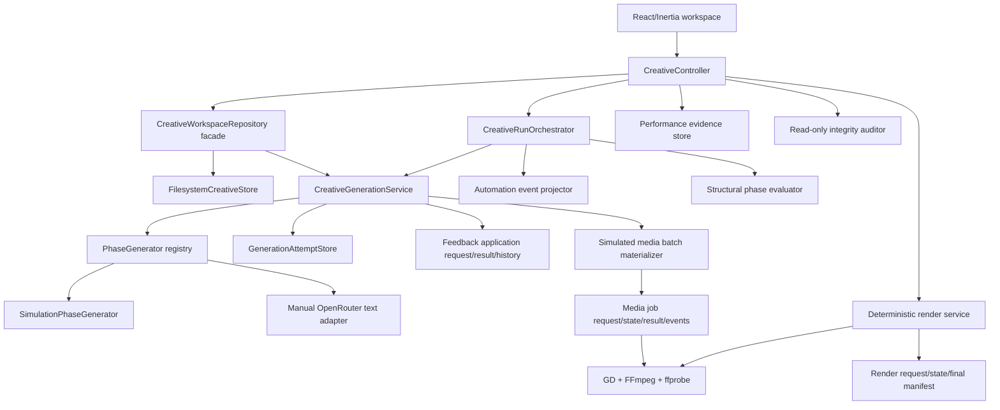

# VideoAuto API-free implementation audit

**Audit date:** 2026-07-28  
**Scope:** Current Laravel/React code, filesystem contracts, simulation workflow, local media/rendering, and tests  
**Safety boundary:** No provider request was made. The audit does not require secrets, live provider checks, smoke commands, or changes to existing creative projects.

## Executive conclusion

VideoAuto has moved beyond a UI prototype and now has a credible filesystem-first production foundation. A person can trace an advertisement from `project.md`, through immutable alternatives and selections, into deterministic local PNG/MP4 fixtures and a final FFmpeg assembly. The automatic path is bounded, replayable, explainable, and simulation-only.

What the system proves today is **workflow correctness and recovery**, not creative quality. The evaluator is deliberately structural, the media are deterministic fixtures, the audio is a timing-reference tone rather than speech, and performance learning is manual evidence ranking rather than causal optimization. Those limitations are visible in files and UI instead of being presented as completed provider work.

The strongest next step is therefore not another architecture rewrite. It is to map paid provider adapters onto the existing job and artifact contracts one at a time, while keeping simulation as the regression oracle.

## Architecture actually present



The compatibility repository still assembles the workspace read model and coordinates some high-level actions, but generation, attempts, validation, eligibility, shot planning, automation, media jobs, rendering, integrity, and performance evidence now have separate owners.

## Goal versus current behavior

| Product goal                             | Current evidence                                                                                                                                                                                  | Audit result                                                  |
| ---------------------------------------- | ------------------------------------------------------------------------------------------------------------------------------------------------------------------------------------------------- | ------------------------------------------------------------- |
| Files are the recoverable creative truth | `FilesystemCreativeStore`, `MarkdownDocument`, phase outputs, selections, decisions, attempts, evaluations, automation events, media jobs, renders, and performance records                       | Implemented                                                   |
| Regeneration never overwrites history    | Immutable artifact/attempt/result writes and unique IDs; selection is a separate record                                                                                                           | Implemented                                                   |
| Ideas is genuinely optional              | `decisions/ideas-source/` stores an append-only `project_idea` skip or `selected_idea` decision; the latest valid decision controls Concepts lineage                                              | Implemented                                                   |
| Script controls the shot list            | `ShotPlanResolver` validates/canonicalizes 1–12 stable shots and downstream snapshots must match                                                                                                  | Implemented                                                   |
| Invalid files cannot advance             | `CreativeArtifactValidator`, `MediaAssetContract`, and `CreativeArtifactEligibilityVerifier` block malformed, stale, uncommitted, wrong-shaped, lineage-divergent, or binary-mismatched artifacts | Implemented for schema v1; legacy files remain inspectable    |
| Automatic work is bounded and resumable  | `AutomationPolicy`, event/attempt/evaluation projection, checkpoint and terminal-side-effect reconciliation, retry/unit limits, token-bound gate decisions, and run-level locking                 | Implemented in simulation                                     |
| Automatic choices are explainable        | Phase-specific structural dimensions, immutable evaluation files, exact recommendations, selection reasons, and retry diagnosis context                                                           | Implemented; not a semantic quality judge                     |
| Media work has operational states        | Media job request, atomic state and claim, terminal result, append-only events, staging, probing, hashing, cancellation, timeout, and stale-running recovery                                      | Implemented locally; queue-capable, synchronous by default    |
| A complete local output can be rendered  | Exact Sequence/Scene artifact IDs, selection-record IDs, and scene hashes feed FFmpeg; result includes final MP4, captions, timing WAV, voice timing document, probe data, and manifest hashes    | Implemented as deterministic simulation delivery              |
| Outcomes can become reusable evidence    | Immutable manually entered metrics and source-hashed rankings across project runs                                                                                                                 | Implemented as evidence, not automatic learning or causality  |
| Access boundary is explicit              | `EnsureCreativeLocalAccess` rejects non-loopback direct peers and unsupported modes; the ADR separately forbids publishing a locally terminating proxy or tunnel                                  | Implemented for direct-peer access; deployment caveat applies |

## Closed high-priority findings

| Severity | Former risk                                                          | Evidence of correction                                                                                                                                                                                                                                 | User impact now                                                                                             |
| -------- | -------------------------------------------------------------------- | ------------------------------------------------------------------------------------------------------------------------------------------------------------------------------------------------------------------------------------------------------ | ----------------------------------------------------------------------------------------------------------- |
| P0       | Tests or automation could contact a configured provider              | PHPUnit forces simulation and the base test harness uses `Http::preventStrayRequests()`; the orchestrator injects simulation independently of the manual driver                                                                                        | API-free tests fail closed on unexpected HTTP                                                               |
| P1       | A schema-v1 artifact could be selected without a committed attempt   | `CreativeArtifactEligibilityVerifier` requires both request and terminal committed result, exact artifact membership, complete batch count, and matching Markdown SHA-256                                                                              | Uncommitted or changed artifacts cannot advance                                                             |
| P1       | A nominally committed batch could have the wrong phase shape         | Eligibility and pre-commit validation require three unique ordered primary candidates for text/Sequence, exactly Image variants A+B per shot, exactly one Scene per shot, unique IDs, and complete candidate ordering                                  | Partial, duplicated, or wrong-slot batches cannot be promoted                                               |
| P1       | Unknown media states could bypass asset checks                       | `MediaAssetContract` accepts only `ready` or `absent_simulation`; ready assets require safe path, hash, bytes, and phase-appropriate probe metadata                                                                                                    | Missing, changed, unsafe, or falsely-ready binaries are blocked                                             |
| P1       | Interrupted automation could write invalid terminal records          | Recovery reconstructs required fields from the immutable request and writes `interrupted`, `cancelled`, or failed terminal evidence                                                                                                                    | Resume does not fabricate a committed attempt                                                               |
| P1       | A crash after `attempt_started` could leave a ghost reservation      | The reservation event stores driver, source IDs, slots, counts, budgets, feedback/lineage hashes, and retry linkage; recovery reconstructs a request tied to that event and writes a valid `interrupted` result                                        | Attempt accounting remains truthful and the next bounded retry does not erase the abandoned attempt         |
| P1       | Losing `state.md` reset budgets or gates                             | `AutomationRunProjector` replays policy, ordered events, attempts, evaluations, and exact selections, then reconciles the mutable checkpoint                                                                                                           | Attempt counts, simulation units, active substeps, and pending gates survive checkpoint loss                |
| P1       | A stored `complete` state could hide changed files                   | Reconciliation compares the projection with current selection/lineage truth and reopens a complete checkpoint when needed                                                                                                                              | Completion follows current filesystem truth                                                                 |
| P1       | Resume/cancel races could overwrite each other                       | Start, step, resume, decide, and cancel use one run-level orchestration lock                                                                                                                                                                           | Compound transitions are serialized                                                                         |
| P1       | “Evaluator” implied creative judgment                                | Evaluations identify themselves as `structural_eligibility` and use named phase-specific structural dimensions                                                                                                                                         | Operators can see exactly what was and was not judged                                                       |
| P1       | Retries repeated the same attempt blindly                            | Prior evaluation ID, diagnosis, fatal issues, exact gate-event/feedback hashes, and an applied-generation-feedback hash are linked through the next deterministic request and candidates                                                               | Retry behavior is traceable and testable                                                                    |
| P1       | A diagnosis-aware retry changed only an opaque counter               | The simulator maps prior diagnosis and pending feedback to a deterministic phase-specific refinement action, writes the action and diagnosis into the candidate, and hashes the context, diagnosis, feedback, and refinement                           | A structural retry has reproducible corrective evidence without claiming creative intelligence              |
| P1       | A generic Resume silently approved a gate                            | Resume refuses awaiting review; only `approve`, `manual_override`, `retry_with_feedback`, or `cancel` on the decision endpoint can cross a gate                                                                                                        | Human gates contain an explicit decision                                                                    |
| P1       | A delayed decision could approve a later gate                        | Each gate exposes the ID of its durable source event as `gate_token`; the controller and orchestrator require an exact match, reject stale tokens, and make a repeated identical decision idempotent                                                   | Retried browser requests cannot decide a different review checkpoint                                        |
| P1       | Replay could skip a gate after reusing a complete phase              | `AutomationRunProjector` treats a replayed `phase_reused` event for any configured gate as `awaiting_review`, even without a later `gate_requested` event                                                                                              | A crash between gate-related events cannot silently advance automation                                      |
| P1       | A selection file could commit before its automation event            | Recovery appends the missing `selection_recorded` event only when the current effective immutable selection is automation-owned and exactly matches the expected slot, artifact, and evaluation                                                        | A crash window is repaired without accepting an unrelated manual or stale selection                         |
| P1       | Five fixed shots distorted every script                              | Typed `shot_plan` metadata defines IDs, order, timing, purpose, and visual; Images/Scenes/Sequence use those slots                                                                                                                                     | Runs can use different valid shot counts without losing lineage                                             |
| P1       | Structured shots could disagree with the readable script             | Schema-v1 Brief & Script requires a typed 1–12-shot plan and matching timed Markdown; only an artifact with no `schema_version` may derive a legacy plan from its body                                                                                 | Machine lineage and the document reviewed by a person describe the same timing                              |
| P1       | Sequence metadata could preserve a stale generated scene plan        | Generation overwrites every Sequence candidate with the canonical ordered plan and scene IDs derived from current selected Scene snapshots; validation requires `source_artifact_ids === scene_artifact_ids`, one scene per shot, and the current plan | A provider or fixture cannot redefine the effective edit manifest                                           |
| P1       | Media sidecars looked like real media                                | Simulation now creates actual local PNG/MP4 fixtures and records `media_job_id`, `asset_sha256`, `asset_bytes`, and `media_probe`                                                                                                                      | Media cards can refer to a verifiable binary                                                                |
| P1       | A valid video file could have the wrong shot length                  | Ready Scene validation compares probed duration with `end_seconds - start_seconds` and permits only the explicit 0.125-second low-FPS container tolerance                                                                                              | Duration-mismatched clips are invalid for selection and rendering                                           |
| P1       | Duplicate queue delivery could process one job twice                 | Media and render stores atomically claim only `pending` work under entity locks; a second worker receives `claimed: false` and returns the existing state                                                                                              | Redelivery cannot duplicate local work or rewrite a terminal result                                         |
| P1       | Cancellation could race final asset publication                      | Media and render promotion callbacks execute under the same entity lock as cancellation and write completed terminal evidence inside that critical section; cancellation winning first skips publication                                               | The final state is either cancelled before promotion or consistently completed                              |
| P1       | A failed render promotion could expose a partial delivery            | Final MP4, timing audio, captions, and voice document remain staged through preflight; promotion failures remove only hard links whose inode proves they came from this staging set                                                                    | Unrelated collisions are preserved and an incomplete delivery is not published as final                     |
| P1       | Render lineage ignored reselection of the same artifact              | The immutable render request records Sequence and Scene selection-record IDs as well as artifact IDs and hashes, then re-resolves and compares all identities after claim                                                                              | A newer append-only selection invalidates the older render request even when it points to the same artifact |
| P1       | Feedback could be archived without proving application               | Generation snapshots both feedback sources and constructs the exact payload while their locks are held; commit links history to attempt/artifact/hash evidence, failure preserves the inbox, and later notes remain pending                            | “Applied” means a committed batch consumed the recorded bytes                                               |
| P1       | A crash could leave generation side effects unresolved               | Before every checkpoint projection, committed attempts finish reserved feedback as applied; failed/cancelled/interrupted attempts write `not_applied`, and unfinished media jobs owned by unsuccessful attempts are terminalized truthfully            | Resume repairs crash windows without clearing new feedback or abandoning media jobs                         |
| P1       | Feedback reserved before the attempt manifest could become ambiguous | Event-only attempt recovery reuses the reserved generation-feedback hash, writes `not_applied` for that interrupted attempt, and leaves the current inbox bytes pending                                                                                | Recovery records that the feedback was not consumed and does not silently archive it                        |
| P1       | Retry feedback could be appended twice before its gate event         | The inbox note carries the durable gate token and feedback hash; recovery reuses an exact match and rejects a different note for the same gate before recording the decision                                                                           | Retried gate requests do not duplicate or silently replace pending feedback                                 |
| P1       | Integrity could disagree with runtime automation replay              | `CreativeIntegrityAuditor` invokes the same `AutomationStateStore` validation and `AutomationRunProjector` used by runtime recovery, then reports rejected evidence, checkpoint divergence, and current-filesystem contradictions                      | Audit and resume use one canonical interpretation of automation history                                     |
| P1       | Forward-only checks missed detached applied history                  | Feedback integrity walks applied history back to its named application result and reports snapshots not listed by a readable applied terminal record; selection and attempt audits also check their referenced targets                                 | Detached evidence remains visible instead of looking valid because no parent record was visited             |
| P1       | Access was an unresolved deployment question                         | The local-access ADR is accepted and middleware covers every creative route; it explicitly requires loopback binding and prohibits publishing a locally terminating proxy or tunnel                                                                    | Non-loopback direct peers fail closed; safe deployment still matters when a relay appears as loopback       |

## Media and batch behavior

For an Images or Scenes generation attempt, every intended media request is reserved before processing begins. Each request records the generation attempt, shared batch ID, index, batch size, intended artifact, media type, output path, parameters, timeout, and local renderer identity.

Each job then moves through:

```text
pending -> running -> completed
                   -> failed
                   -> cancelled
                   -> timed_out
```

The transition from `pending` to `running` is an atomic claim under the job lock; duplicate queue deliveries return the existing state without rendering again. The renderer writes into an attempt-specific staging directory. Only a successfully decoded/probed file is hard-linked to its immutable final asset path. Final promotion and the completed result use the same job lock as cancellation: cancellation winning first prevents promotion, while completion winning first leaves one consistent terminal record. The result records byte size, SHA-256, MIME type, codec, dimensions, duration where applicable, and audio codec where present. Ready Scene duration must match its canonical shot window within 0.125 seconds, the maximum single-frame rounding used by the 8 fps fixture path. If any member fails, the generation attempt does not commit its sidecar batch; the already-written job records and binaries remain as evidence. Recovery can reconcile an expired running job to `completed` when a valid promoted binary exists, otherwise it records `timed_out` without deleting files. Automation recovery additionally closes pending/running jobs owned by an unsuccessful parent attempt before spending another bounded attempt.

The standalone queued-media coordinator now persists the complete batch and every prepared sidecar before dispatch, automatically reconciles parent state after worker success/failure, keeps binaries batch-private, and publishes sidecars only after every child succeeds. It is covered by the main operational integrity audit. The current integrated generation path still processes locally and synchronously; wiring the coordinator into generation requires a durable `waiting_for_media` result across HTTP, UI, automation, feedback, and attempt accounting. A terminal failed, cancelled, or timed-out child currently terminalizes the batch and cannot be independently retried or replaced.

## Render and learning behavior

Rendering is a separate explicit action after Sequence selection. `RenderInputResolver` requires exactly one valid effective Sequence and every selected Scene binary, checks their current hashes, and rejects a stale Sequence whose scene IDs no longer match. The immutable request pins the effective Sequence and Scene selection-record IDs as well as artifact identities; after the render atomically claims pending work, it re-resolves every input and refuses to assemble if a newer selection record exists—even if that record promotes the same artifact.

The local renderer concatenates the exact selected MP4 fixtures, creates shot-timed SRT captions, generates a quiet deterministic timing tone, embeds captions/audio into `final.mp4`, probes the outputs, and writes an immutable manifest containing input artifact IDs, selection IDs, source binary hashes, output hashes, byte counts, and media metadata. Final MP4, timing WAV, captions, and voice document remain in staging until all pass preflight; their multi-file promotion and completed result share the render cancellation lock, and a failed promotion rolls back only links proven to originate from this staging set. The accompanying `voice-script.md` explicitly records `voice_generated: false`.

Performance ingestion accepts manually observed counts and monetary values only for a completed render whose current bytes match its manifest. It calculates rates such as completion rate, CTR, CPM, CPC, conversion rate, and ROAS when denominators exist. Project learning files rank records by a chosen metric and hash every source record; they state that correlation is not causation and do not silently modify future prompts.

## Remaining findings

| Priority            | Class                   | Current limitation                                                                                                                                                          | Recommended next action                                                                                                                                                                              |
| ------------------- | ----------------------- | --------------------------------------------------------------------------------------------------------------------------------------------------------------------------- | ---------------------------------------------------------------------------------------------------------------------------------------------------------------------------------------------------- |
| P1 before paid APIs | Provider integration    | fal.ai and ElevenLabs are adapter/smoke code, not artifact-producing media workers; automatic mode deliberately rejects provider drivers                                    | Implement one provider job adapter at a time behind the media request/result contract, with idempotency, download validation, normalized latency/usage/cost, and fake-HTTP failure tests             |
| P1 before paid APIs | Async generation wiring | A durable standalone coordinator proves queued batch membership, reconciliation, recovery, and all-or-nothing sidecar publication, but normal generation does not select it | Add `waiting_for_media` semantics to generation, HTTP/UI progress, automation resume/cancel, feedback finalization, and attempt commit; then make sync and queue scheduling use the same coordinator |
| P1 before paid APIs | Per-shot recovery       | Child jobs have independent identities, but a terminal child failure currently terminalizes its batch and has no retry/replacement transition                               | Add immutable replacement-attempt identity and bounded per-shot retry before paid Scene generation, without rebuilding or invalidating unaffected selected Scenes                                    |
| P2                  | Evaluation quality      | Rubrics judge contracts and required structure, not brand fit, persuasion, visual quality, safety nuance, or factual accuracy                                               | Introduce inspectable semantic rubrics only when a deterministic/local or explicitly authorized evaluator exists; never relabel structural scores as creative quality                                |
| P2                  | Render realism          | Captions use shot purpose and audio is a timing tone; there is no spoken voice, dialogue alignment, music, loudness normalization, or production color/audio QA             | Connect voice/caption generation and media QA through queued artifacts after provider authorization                                                                                                  |
| P2                  | Cancellation            | Cancellation is cooperative at checkpoints; it does not forcibly terminate an already-running local FFmpeg subprocess                                                       | Add process identifiers/heartbeats and a carefully scoped worker cancellation strategy if long jobs require it                                                                                       |
| P2                  | Learning                | Performance is manually entered and ranked; it is not imported from platforms or retrieved into later generation                                                            | Add validated imports and an explicit evidence-retrieval step while preserving source records and uncertainty                                                                                        |
| P2                  | Remote product          | Direct-peer loopback enforcement plus the no-public-relay deployment rule is correct today but does not support collaboration                                               | If remote use becomes a goal, design ownership, authorization, spend permissions, identity-bearing audit records, and migration before changing the ADR                                              |

## Safe proof strategy

The API-free acceptance path should remain:

1. Run all tests with `CREATIVE_GENERATION_DRIVER=simulation`; unmatched HTTP must be rejected.
2. Exercise a complete six-phase run with at least one non-five-shot script.
3. Verify immutable attempt/evaluation/selection/source-decision records and dynamic shot snapshots.
4. Exercise media `pending`, `running`, `failed`, `cancelled`, `timed_out`, recovery, probe, and hash failures with fixtures.
5. Build a local render, verify every manifest hash, then prove a changed binary is detected.
6. Record sample performance evidence and regenerate a source-hashed ranking.
7. Run the read-only integrity command against temporary fixtures and the preserved creative tree; never “repair” historical files by rewriting them.

```bash
CREATIVE_GENERATION_DRIVER=simulation php artisan test --compact
php artisan creative:integrity
composer types:check
npm run types:check
npm run lint:check
npm run build
```

No live provider check or smoke generation belongs in this proof.
