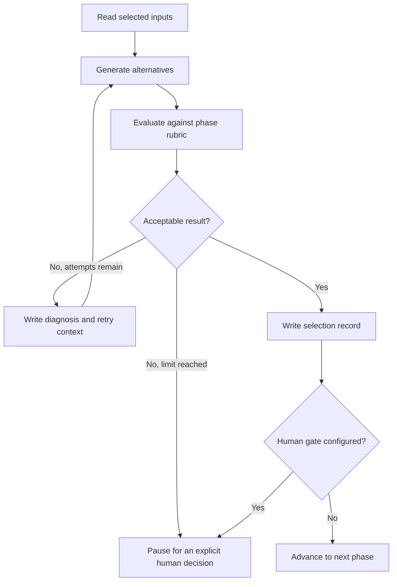
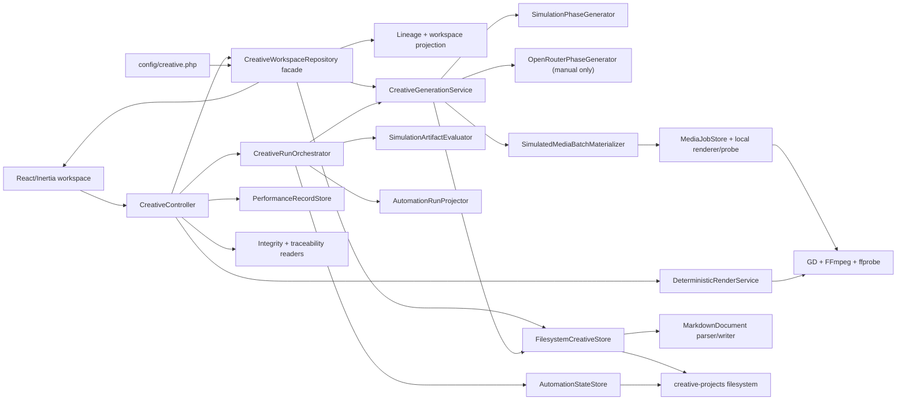

# VideoAuto Creative Production System

**Status:** Canonical product and workflow documentation  
**Current application:** Laravel 13, Inertia, React, TypeScript  
**Creative source of truth:** Files under `creative-projects/`  
**Target output:** A traceable short advertisement, currently designed around a maximum duration of 15 seconds, with deterministic local media/rendering as the API-free proof path

## 1. Purpose

VideoAuto should help a person turn a broad advertising idea into a production-ready video through a sequence of small creative decisions.

The important idea is not simply “generate a video.” The system should make the reasoning and creative history visible:

- What idea started the project?
- Which alternatives were produced at every phase?
- Which option was selected, by whom, and when?
- Which artifact became the input to the next phase?
- What feedback was given?
- What was changed because of that feedback?
- Which images, scenes, and edit plan produced the final result?
- Which attempts failed or were rejected, and what can be learned from them?

This history makes the project useful both as a creative workspace and as a learning system.

## 2. Core mental model

The system has six important objects.

### Project

A project represents the enduring advertisement goal: the product, audience, broad idea, and desired result. Its identity lives in `project.md`.

### Run

A run is one complete attempt to move through the production chain. A project can contain many runs, allowing different strategies or later iterations without changing earlier work.

### Phase

A phase performs one bounded creative job. It receives selected files as input and creates new alternatives as output.

### Artifact

An artifact is an output file: Markdown, an image plus Markdown sidecar, a video plus Markdown sidecar, or a final render plus manifest. Artifacts are immutable evidence of what was produced.

### Selection

A selection is a separate Markdown record that points to the chosen artifact. It promotes that artifact to become an input of the following phase. It does not copy or modify the artifact.

### Feedback

Feedback records what a person thinks should improve. It can apply to one phase or to the entire run. Pending feedback and archived history are kept separately. A generation attempt reserves the exact pending snapshot under `feedback/applications/{attempt-id}/request.md`; a committed batch writes a terminal application result and applied history with attempt/artifact/hash references, while a failed attempt writes `not_applied` and preserves the inbox. Feedback appended after reservation remains pending. A manual archive still truthfully uses `archived_unapplied` because it has no implementation reference.

## 3. End-to-end creative chain

```mermaid
flowchart LR
    P["Project idea"] --> I["00 Ideas (optional)"]
    P --> C["01 Concept"]
    I -->|"selected idea"| C
    C -->|"selected concept"| B["02 Brief & script"]
    B -->|"selected script"| K["03 Images"]
    K -->|"selected frame per shot"| S["04 Scenes"]
    S -->|"selected clip per shot"| Q["05 Sequence"]
    Q -->|"selected edit plan"| R["Deterministic local render"]
    R --> V["Verified MP4 + captions + timing audio + manifest"]
```



### Phase 00: Ideas — optional

**Purpose:** Explore possible directions when the user has only a broad subject or wants more creative range.

**Input:** `project.md`.

**Expected output:** Three meaningfully different idea files. Each should describe the recognizable moment, emotional tension, product connection, and what the idea is trying to test.

**Gate:** Select one idea. If the user already has a clear idea, this phase can be skipped and the concept phase reads directly from `project.md`.

### Phase 01: Concept

**Purpose:** Turn the broad or selected idea into a precise advertising concept.

**Input:** The selected idea, or `project.md` when Ideas was skipped.

**Expected output:** Three concept files. A concept should define at least:

- the hook;
- the emotional change;
- the product mechanism;
- the creative hypothesis being tested;
- important risks or constraints.

**Gate:** Select one concept.

### Phase 02: Brief & script

**Purpose:** Convert the concept into an executable 15-second story.

**Input:** The selected concept.

**Expected output:** Three Markdown files. The brief and script remain in the same file but are clearly separated. Every schema-v1 candidate carries a canonical 1–12-shot plan whose ID, order, timing, purpose, and visual values agree with the human-readable timed script. Deriving a plan only from Markdown is a compatibility path for genuinely unversioned artifacts, not a schema-v1 fallback:

- purpose;
- audience;
- story summary;
- tone and constraints;
- timed script;
- shot intentions;
- call to action.

**Gate:** Select one brief and script.

### Phase 03: Images

**Purpose:** Design the visual beginning of every scene before spending money on video generation.

**Input:** The selected brief and script.

**Expected output:** Two image alternatives for each planned shot. The selected Brief/Script carries a typed `shot_plan`; its stable shot IDs, order, timing, purpose, and visual description define the Image and Scene slots. In simulation, each alternative has a deterministic local PNG binary; a future paid adapter may replace the fixture renderer without changing the artifact contract.

Each image requires a Markdown sidecar containing its prompt, visual purpose, shot slot, variant, source script, generation provider, model, settings, cost, and asset path.

**Gate:** Select one image for every required shot.

### Phase 04: Scenes

**Purpose:** Animate the selected image for each shot into a short clip.

**Input:** One selected keyframe per shot.

**Expected output:** One Scene candidate for each shot in each generation batch; regenerating creates another immutable attempt. In simulation, each candidate has a deterministic local MP4 whose duration comes from the shot timing. A ready video probe must match `end_seconds - start_seconds` within 0.125 seconds, the explicit one-frame tolerance of the 8 fps fixture renderer. Provider-backed scenes remain future work.

Each video requires a Markdown sidecar containing the source image, motion prompt, intended duration, actual duration, provider, model, settings, cost, validation notes, and asset path.

**Gate:** Select one usable scene for every shot. Current simulation regeneration creates a complete new Scene candidate batch, and a terminal failed child cannot yet be retried or replaced inside its batch. Independent failed-shot retry/replacement is a provider-readiness requirement, not a current capability; it must preserve unaffected selected Scenes rather than rebuilding them.

### Phase 05: Sequence

**Purpose:** Decide how the selected scenes, voice, captions, sound, product UI, and call to action should be assembled.

**Input:** The selected scene for every shot.

**Expected output:** Exactly three unique primary edit-plan candidates per committed schema-v1 batch. Every candidate carries the same canonical ordered `shot_plan` and `scene_artifact_ids` derived centrally from the current selected Scene snapshots; `source_artifact_ids` must exactly equal that ordered scene manifest. The human document specifies order, in/out times, caption timing, voice timing, sound notes, transitions, aspect ratio, and final duration.

**Gate:** Select the editor handoff.

### Deterministic local delivery

Sequence selection completes the six creative phases. A separate explicit delivery action is now implemented for the API-free path. Its immutable request pins the Sequence and Scene artifact IDs, their append-only selection-record IDs, and the Scene binary hashes. After atomically claiming `pending` work, it re-resolves those inputs and refuses to assemble if any effective selection record or binary identity changed, then uses local FFmpeg to concatenate the clips, embed an SRT caption stream, add a quiet timing-reference tone, and prepare a final MP4 plus source-hashed manifest. Final video, timing audio, captions, and voice document remain staged until preflight succeeds. Their promotion and completed record share the cancellation lock; if promotion fails, only hard links proven to come from that staging set are rolled back.

This renderer proves deterministic assembly and traceability; it is not yet a production audio finish. `voice-script.md` records the intended shot timing and explicitly says that no speech was synthesized. Future provider-backed voice, semantic captions, music, and media generation must enter through the same queued, validated artifact contracts rather than bypassing the filesystem history.

## 4. Sequential human-in-the-loop mode

The current interface is designed around this loop:

1. Open a project and run.
2. Enter the active phase.
3. Inspect the selected input from the previous phase.
4. Generate new alternatives.
5. Open any artifact and inspect its rendered sections or raw Markdown.
6. Add phase-level or run-level feedback.
7. Generate more alternatives if necessary; previous versions remain.
8. Select the strongest artifact or one artifact per required shot.
9. The application writes immutable selection records.
10. When the phase has all required selections, continue to the next phase.

The person is not asked to approve an abstract status. They choose the actual file that moves forward. That makes the creative decision concrete and traceable.

## 5. Automatic simulation mode

Automatic mode does not bypass the production chain. The current implementation automates the same generation, validation, evaluation, and selection actions with the local deterministic simulator only.



### Automation levels

The application supports these working policies per run:

1. **Manual:** every generation and selection is initiated by a person.
2. **Supervised automatic:** implemented in simulation with configurable phase gates; the default gates are Brief & Script and Sequence.
3. **Automatic:** implemented in simulation by configuring no human gates. Provider-backed automatic work is deliberately unsupported.

The current evaluator is explicitly a **structural eligibility** evaluator. It uses named phase-specific dimensions and proves that required structure, provenance, lineage, shot snapshots, and human-readable sections are present. Equal scores use immutable one-based batch candidate order before artifact ID. On retry, the simulator deterministically maps the prior diagnosis and pending feedback to a phase-specific refinement action, adds an inspectable refinement section, and records hashes for the context, diagnosis, feedback, and action; the evaluator verifies that retry evidence. This proves a reproducible structural response, not persuasion, taste, brand fit, visual quality, or semantic improvement.

At a gate, a person chooses `approve`, `manual_override`, `retry_with_feedback`, or `cancel`. The UI must submit the exact `gate_token`, which is the immutable source-event ID for that review checkpoint. The orchestrator rejects a missing or stale token and treats an identical retry for the same token as idempotent, so a delayed browser request cannot decide a newer gate. The immutable decision event records exact selections; retry feedback and the prior evaluation diagnosis are linked into the next bounded request through exact event and content hashes. Generic resume is recovery-only and cannot cross an awaiting-review gate.

### Rules for safe automation

- Use the same artifact and selection files as manual mode.
- Record the generator, model, prompt version, settings, and cost for every attempt.
- Use structured evaluation rubrics appropriate to each phase.
- Set maximum attempts and simulation-unit budgets before a run begins. Real provider cost remains exactly `$0.00` in automatic mode.
- Pause when scores are ambiguous, required information is missing, generation fails repeatedly, or a configured boundary is reached.
- Never erase rejected or failed attempts.
- Make every automatic selection explainable through an evaluation artifact.
- Allow a person to override an automatic selection by creating a newer selection record.
- Resume safely from the filesystem after a process failure rather than restarting the run. An attempt request without a terminal result is retained as valid interrupted evidence and a new immutable attempt is created. If the process died earlier—after `attempt_started` but before the request manifest—the full reservation event reconstructs a request linked by `recovered_from_event_id` and a valid `interrupted` result.
- Rebuild effective automation state from the immutable policy, ordered events, attempts, evaluations, and selections. Treat `state.md` as a repairable checkpoint rather than the sole truth.
- If an automatic selection record committed before `selection_recorded`, backfill the event only when the current effective record exactly proves the expected automation evaluation, slot, and artifact.
- Project a configured human gate directly from either `phase_completed` or `phase_reused`; replay must remain `awaiting_review` even when a crash prevented a later gate event.
- Preserve attempt counters, simulation units, retry context, and pending gates when the checkpoint is missing or inconsistent.
- Serialize start, resume, decision, and cancellation transitions under one run-level lock.
- Reconcile a recorded complete state against current filesystem lineage; reopen it when current selections no longer prove completion.
- Before projecting a checkpoint, reconcile terminal generation side effects: complete reserved feedback applications from committed attempts, preserve feedback as `not_applied` for unsuccessful or event-only interrupted attempts without clearing the inbox, and terminalize their unfinished media jobs.
- Make retry-feedback writes gate-token/hash idempotent so a crash after appending the note but before its decision event neither duplicates nor replaces that note.

## 6. Filesystem and lineage contract

```text
creative-projects/
└── {project-slug}--{project-id}/
    ├── project.md
    ├── learning/
    └── runs/
        └── {utc-date-time}--{run-id}/
            ├── run.md
            ├── 00-ideas/outputs/
            ├── 01-concepts/outputs/
            ├── 02-brief-script/outputs/
            ├── 03-images/outputs/
            ├── 04-scenes/outputs/
            ├── 05-sequence/outputs/
            ├── {numbered-phase}/attempts/{attempt-id}/
            │   ├── request.md
            │   └── result.md
            ├── {numbered-phase}/evaluations/
            ├── {numbered-phase}/assets/
            ├── {numbered-phase}/media-jobs/{job-id}/
            │   ├── request.md
            │   ├── state.md
            │   ├── result.md
            │   ├── events/
            │   └── staging/
            ├── selections/
            │   ├── ideas/
            │   ├── concepts/
            │   ├── brief-script/
            │   ├── images/
            │   ├── scenes/
            │   └── sequence/
            ├── decisions/ideas-source/
            ├── feedback/
            │   ├── current/
            │   │   ├── cycle.md
            │   │   └── phase-{phase}.md
            │   ├── applications/{attempt-id}/
            │   │   ├── request.md
            │   │   └── result.md
            │   └── history/
            ├── automation/
            │   ├── policy.md
            │   ├── state.md
            │   └── events/
            ├── renders/{render-id}/
            │   ├── request.md
            │   ├── state.md
            │   ├── manifest.md
            │   ├── final.mp4
            │   ├── captions.srt
            │   ├── timing-reference.wav
            │   └── voice-script.md
            └── performance/records/
```

Project-level source-hashed rankings are stored under `{project}/learning/`.

### Naming

Project, run, artifact, selection, and feedback-history filenames combine a UTC timestamp, semantic type, short random identifier, and readable slug. Random identifiers prevent collisions; timestamps make the history easy to browse.

### Artifact metadata

Markdown front matter is the machine-readable envelope. The body is the human-readable creative content.

```yaml
---
schema_version: 1
id: 20260721-093633--brief-script--abc123--start-with-something-real
artifact_type: markdown
phase: brief-script
slot: primary
title: Start with something real
summary: A concise statement of the option
created_at: 2026-07-21T09:36:33+00:00
generation_attempt_id: 20260721-093630--generation--xyz789--brief-script
source_artifact_ids:
    - selected-concept-id
generator: simulation
prompt_version: brief-script-simulation-v1
settings:
    driver: simulation
usage: []
cost_usd: 0.00
status: ready
simulation: true
---
```

Every artifact requires nonempty `id`, `artifact_type`, `phase`, `slot`, `title`, `summary`, and a valid `created_at`, plus a nonempty body with phase-required sections. New schema-v1 artifacts additionally require `generation_attempt_id`, `generator`, `prompt_version`, `status`, boolean `simulation`, `settings`, `usage`, numeric-or-null `cost_usd`, and a nonempty unique `source_artifact_ids` list. Brief & Script requires a valid `shot_plan` that matches the timed Markdown; Image and Scene sidecars require an exact `shot` snapshot, Images require a `variant`, and Sequence requires the exact current ordered scene manifest and canonical plan.

Media declared `ready` additionally requires a safe relative `asset_path`, lowercase SHA-256, positive byte count, and a probe mapping with media type, MIME, codec, positive dimensions, and positive duration for video. A ready Scene duration must match its shot window within 0.125 seconds. `asset_status` accepts only `ready` or the deliberately non-binary legacy/simulation state `absent_simulation`. Older artifacts remain readable with provenance warnings, but the eligibility layer decides whether they may advance.

### Immutability rules

1. Generation always creates new output files.
2. An artifact is never edited to represent a new attempt.
3. A selection is an append-only pointer to an artifact.
4. When several selections exist for the same phase slot, the newest record is the effective selection; older records remain as history.
5. The following phase resolves its inputs from effective selection records.
6. A new run creates a clean phase workspace without changing earlier runs.
7. Media binaries and their Markdown sidecars share a stable identity.
8. A schema-v1 artifact is selectable only when its immutable attempt result proves a complete committed batch and the artifact's current Markdown hash matches that result.
9. A ready binary is selectable only while its current bytes and hash match the sidecar.
10. Ideas selection and Ideas skipping are both append-only source decisions; a newer valid decision supersedes rather than deletes history.
11. Schema-v1 attempt request/result metadata, driver, phase, slots, source lineage, expected counts, ordered artifact members, and the complete hash map must agree; every committed batch member must still exist and match before any member is selectable.
12. Generated batch shape is fixed by phase: three unique primary candidates for Ideas/Concepts/Brief & Script/Sequence, variants A+B for each Image shot, and one Scene for each shot, with unique IDs and complete one-based candidate ordering.

## 7. Feedback and improvement loop

Feedback serves two different purposes.

### Phase feedback

Specific observations about the current output, such as “the hook must work without sound” or “the face looks artificial.” This belongs in `feedback/current/phase-{phase}.md`.

### Whole-run feedback

Observations about the chain itself, such as “the brief needs a stronger product-proof field” or “five shots are too many for this concept.” This belongs in `feedback/current/cycle.md`.

### Applying feedback to creative generation

The implemented generation lifecycle is:

1. A person records phase or whole-run feedback in the interface.
2. A generation attempt locks the phase and whole-run inbox sources, snapshots their exact pending bytes, and constructs the complete generator payload while both source locks are held.
3. The generator receives that payload together with the selected source artifacts; the attempt and feedback-application request record the same SHA-256.
4. If the whole output batch commits, the application writes an `applied` result and dated history records linked to the attempt, every artifact, and the generation-feedback hash.
5. If generation fails, the application writes `not_applied` and leaves the feedback pending.
6. Feedback appended after the reservation is not consumed by that attempt and remains pending.

Here, `applied` has a deliberately narrow meaning: the exact snapshot was supplied to a committed generation batch. It does not claim that the creative result improved. The application exposes the request, result, hashes, and implementation references so a person can assess that separately.

### Archiving without generation

The manual “Move current to history” action is also supported, but it writes `archived_unapplied`. This is useful for triage or superseded notes and never claims that code, prompts, settings, or creative output changed. A future workflow for process/code improvements should require explicit implementation locations and verification evidence rather than reusing the generation-consumption meaning above.

## 8. Current application architecture



### Important implementation files

- `config/creative.php`: phase order, labels, single/dynamic selection modes, access mode, and generation defaults.
- `routes/web.php`: project, run, generation, selection, and feedback endpoints.
- `app/Http/Controllers/CreativeController.php`: HTTP validation and navigation.
- `app/Creative/CreativeWorkspaceRepository.php`: compatibility facade for project/run lifecycle, lineage, selection, feedback, and the workspace read model.
- `app/Creative/FilesystemCreativeStore.php`: low-level filesystem storage boundary.
- `app/Creative/CreativeArtifactEligibilityVerifier.php`: committed-attempt hash, media-asset, and selection eligibility checks.
- `app/Creative/MediaAssetContract.php`: closed media status enum plus required binary identity and probe metadata.
- `app/Creative/Generation/`: generator contract, simulator/provider adapters, attempt manifests, and generation transaction service.
- `app/Creative/Automation/`: policy, structural phase evaluator, event/attempt/evaluation projector, checkpoint storage, and resumable simulator-only orchestrator.
- `app/Creative/Media/`: deterministic local PNG/MP4/audio fixtures, media job lifecycle, staging, probing, hashing, cancellation, timeout, and recovery.
- `app/Jobs/ProcessSimulatedMediaJob.php`: queue entry point for one local simulated media job.
- `app/Creative/Rendering/`: exact-input resolution, deterministic FFmpeg assembly, render state, and final manifest.
- `app/Jobs/ProcessDeterministicRender.php`: queue entry point for local delivery.
- `app/Creative/Learning/PerformanceRecordStore.php`: immutable observed performance records and source-hashed project rankings.
- `app/Creative/ShotPlanResolver.php`: typed plan validation plus legacy timed-Markdown derivation.
- `app/Creative/CreativeIntegrityAuditor.php` and `CreativeOperationalIntegrityAuditor.php`: read-only artifact, automation, media-job, and render diagnosis used by `creative:integrity`.
- `app/Creative/CreativeTraceabilityReader.php`: attempts, evaluations, selections, source decisions, media jobs, and automation events for the workspace.
- `app/Creative/OpenRouterCreativeGenerator.php`: structured three-option text generation and script-polish pipeline.
- `app/Creative/Providers/`: small OpenRouter, fal.ai, and ElevenLabs API adapters.
- `app/Console/Commands/CreativeProvidersCommand.php`: non-generation credential checks.
- `app/Console/Commands/CreativeSmokeCommand.php`: one explicitly authorized lightweight provider generation.
- `app/Creative/MarkdownDocument.php`: YAML front matter and Markdown section parsing.
- `resources/js/pages/creative/workspace.tsx` and `resources/js/components/creative/`: phase UI, explicit gates, metadata/traceability, recovery, integrity, render delivery, and performance evidence.
- `creative-projects/`: real creative project data visible to the interface and external agents.

Creative project state is intentionally not stored in relational tables. SQLite is still present for Laravel framework features such as authentication, sessions, cache, and queues.

## 9. What works now and what remains

| Capability                                                                                   | Status                                                                                                                                              |
| -------------------------------------------------------------------------------------------- | --------------------------------------------------------------------------------------------------------------------------------------------------- |
| Create projects and independent runs                                                         | Implemented                                                                                                                                         |
| Navigate the six production phases                                                           | Implemented                                                                                                                                         |
| Inspect rendered/raw Markdown and structured front matter                                    | Implemented                                                                                                                                         |
| Preserve every generated attempt and candidate batch                                         | Implemented with immutable request/result and artifact hashes                                                                                       |
| Validate artifacts before selection                                                          | Implemented for schema v1; invalid/ambiguous legacy media is blocked                                                                                |
| Detect missing, invalid, stale, or orphaned selections and reverse-orphaned feedback history | Implemented                                                                                                                                         |
| Make Ideas skipping explicit and traceable                                                   | Implemented with append-only source decisions                                                                                                       |
| Derive Image/Scene slots and timing from the selected script                                 | Implemented                                                                                                                                         |
| Require one selection per dynamic media slot                                                 | Implemented                                                                                                                                         |
| Record phase and whole-run feedback                                                          | Implemented                                                                                                                                         |
| Trace feedback actually supplied to committed generation                                     | Implemented with source-locked payload construction, immutable request/result, source hashes, and implementation references                         |
| Archive feedback manually without falsely claiming application                               | Implemented as `archived_unapplied`                                                                                                                 |
| Apply pending feedback to a committed generation batch                                       | Implemented with exact snapshot hashes and attempt/artifact references                                                                              |
| Prove that applied feedback improved creative performance                                    | Not implemented; requires later outcome evidence                                                                                                    |
| Link process/code feedback to implementation locations and verification                      | Not implemented                                                                                                                                     |
| Generate contextual provider text                                                            | Existing explicit manual OpenRouter path only                                                                                                       |
| Generate actual local image and video binaries                                               | Implemented as deterministic PNG/MP4 simulation fixtures                                                                                            |
| Store media hashes, bytes, probes, job state, and events                                     | Implemented with atomic pending claims and cancellation-safe final promotion                                                                        |
| Queue local media/render work                                                                | Render and isolated jobs are queue-capable; a durable media-batch coordinator is proven standalone, while integrated generation remains synchronous |
| Evaluate and select outputs automatically                                                    | Implemented as structural simulation with phase dimensions and hashed diagnosis-aware refinement evidence                                           |
| Enforce attempt/unit budgets and explicit human gates                                        | Implemented in simulation only                                                                                                                      |
| Replay automation after checkpoint loss                                                      | Implemented from events, attempts, evaluations, selections, gates, and terminal attempt side effects                                                |
| Cancel/resume and reconcile completed workflows                                              | Implemented with run-level locking and current filesystem truth                                                                                     |
| Diagnose stale/broken/incomplete artifacts and operations                                    | Implemented with read-only CLI, reverse orphan checks, and canonical runtime automation replay                                                      |
| Expose front matter, reasons, attempts, evaluations, events, jobs, and feedback history      | Implemented                                                                                                                                         |
| Enforce creative-route deployment boundary                                                   | Implemented for non-loopback direct peers; loopback binding and the local-relay deployment caveat still apply                                       |
| Assemble a local final video                                                                 | Implemented with exact identities, atomic claim/promotion, multi-file rollback, FFmpeg, captions, timing tone, and manifest                         |
| Generate production voice/music/semantic captions                                            | Not implemented                                                                                                                                     |
| Record performance and reusable rankings                                                     | Implemented for manual observations with source hashes                                                                                              |
| Import platform performance or infer causal learning                                         | Not implemented                                                                                                                                     |
| Connect paid image/video/voice providers to artifacts                                        | Not implemented; deliberately disconnected                                                                                                          |

The workspace posts to the truthful `/generate` route; `/simulate` remains a simulation-only compatibility endpoint and can never choose a provider. `CREATIVE_GENERATION_DRIVER=simulation` is the default. Explicit `openrouter` mode sends selected text and pending feedback to OpenRouter for its supported text phases; legacy `auto` remains accepted for compatibility and is disclosed in the UI. Images and Scenes still use the local simulator even when the manual text driver is OpenRouter because paid media adapters are not connected.

## 10. Provider boundary

The canonical development and verification path is API-free. `CREATIVE_GENERATION_DRIVER=simulation` is the default, automatic mode always injects simulation, local media jobs use GD/FFmpeg/ffprobe, and the delivery renderer uses FFmpeg. This complete path records `$0.00` and must remain testable without provider credentials.

Provider secrets belong only in the private `.env`; they must never be printed, copied into creative files, or committed. The codebase retains:

- an existing explicitly configured manual OpenRouter path for Ideas, Concepts, Brief & Script, and Sequence;
- fal.ai and ElevenLabs adapter and smoke-command code that is not connected to media artifacts;
- fake-HTTP provider tests.

No paid provider is used by automatic mode, Images, Scenes, local delivery, or performance evidence. Live provider checks and smoke commands are outside the API-free acceptance procedure and should be run only in a separately authorized session.

The next provider integration must be a worker behind the existing media-job contract. It must preserve immutable requests/results/events, idempotency, normalized latency/usage/cost, bounded retries/timeouts, untrusted-download validation, staging, probing, binary hashes, batch completion, cancellation, and recovery. Controllers and the FFmpeg renderer must not call providers directly.

## 11. Recommended implementation order

### Completed API-free foundation

The application now has:

- separated storage, validation/eligibility, generation, evaluation, orchestration, media-job, render, and evidence services;
- committed attempt manifests, exact phase batch-shape validation, and strict schema-v1/media eligibility;
- typed dynamic shots, exact Sequence manifests, Scene duration checks, and append-only Ideas source decisions;
- structural phase rubrics, hashed phase-specific diagnosis-aware refinements, token-bound human decisions, bounded policies, and run-level transition locks;
- event/attempt/evaluation/selection projection that repairs lost or inconsistent checkpoints, reconstructs event-only attempts as interrupted evidence, preserves gates from their source events, reconciles terminal feedback/media side effects, and checks completion against current files;
- deterministic local PNG/MP4 jobs with atomic pending-work claims and cancellation-safe promotion, staging, queue entry points, terminal states, timeout, recovery, probe metadata, byte counts, and SHA-256;
- a filesystem-backed queued-media batch coordinator with complete pre-dispatch membership, automatic worker reconciliation, batch-private binaries, append-only events, all-or-nothing sidecar publication, result-fenced recovery, and integrity checks;
- UI traceability and an integrity checker spanning creative and operational records, canonical automation projection, and reverse orphan evidence;
- deterministic FFmpeg delivery with exact artifact and selection-record identities, atomic claims and multi-file promotion, rollback, captions, timing audio, and a final manifest;
- immutable manually observed performance records and source-hashed rankings;
- an accepted direct-peer loopback access boundary with an explicit local-relay deployment caveat.

### 1. Wire the durable batch coordinator into generation

The standalone coordinator now proves independent batch status, exact membership, idempotent worker reconciliation, terminal failure, and sidecar commit only after all members complete. The normal Images/Scenes path still processes synchronously. Before provider callbacks are connected, add a `waiting_for_media` generation outcome and carry it through attempt/feedback finalization, HTTP and UI progress, automation resume/cancel, queue-loss recovery, and the final committed attempt fence. Sync and queue scheduling should then use this same coordinator.

### 2. Connect paid Images first

Implement one provider worker behind the existing media-job request/result interface. Treat downloaded files as untrusted until contained path, content type, decode/probe, dimensions, byte limit, duration, and SHA-256 pass. Record provider request ID, exact model/version/settings, latency, usage, cost/currency, retries, safety status, and normalized failure category.

### 3. Connect Scene/video generation

Reuse the same per-shot job lifecycle and add bounded, immutable retry/replacement semantics for terminal child failures. This is not implemented today. A failed Scene must not invalidate valid Scene artifacts from another generation attempt or require rebuilding unrelated shots.

### 4. Add production voice, captions, and audio finishing

Keep voice, caption, music, and mix artifacts independently traceable. Validate duration/alignment, loudness, stream layout, and final probe data. Preserve the timing tone and voice timing document as an honest local fallback.

### 5. Add verified process improvements and evidence retrieval

Keep the existing generation meaning of `applied`: an exact snapshot was consumed by a committed attempt with artifact references. For feedback about prompts, schemas, rubrics, provider settings, or application code, add a separate lifecycle that requires implementation locations and verification references. Add validated performance imports and an explicit retrieval step for later runs; source-hashed rankings must not silently rewrite prompts or claim causality.

### 6. Design remote ownership only if collaboration becomes a product goal

Do not replace the direct-peer local-access decision or its no-public-relay deployment rule with a bare `auth` middleware. Define project ownership, authorization on every read/write, provider-spend permission, audit identity, sharing, trusted proxies, and migration of existing unowned files first.

## 12. System invariants

The following rules should remain true as the application grows:

- The filesystem can explain how any final result was produced.
- Manual and automatic modes use the same artifact lineage.
- No generation, selection, or feedback history is silently overwritten.
- A phase cannot advance without all of its required selected slots.
- Expensive work happens only after cheaper creative decisions are accepted.
- Provider-specific code remains behind contracts.
- Before paid Scene generation, failed-shot retry/replacement must be implemented without rebuilding unaffected Scenes.
- Automation state can be reprojected from immutable evidence; losing a checkpoint cannot reset its limits or gates.
- Automation is bounded by explicit structural rules, attempt limits, simulation-unit limits, and a zero real-cost limit.
- A person can inspect, stop, override, or resume the process.
- A declared ready media asset must continue matching its contained path, bytes, hash, and probe contract.
- Paid work must preserve the same job states and batch truth already proven by local fixtures.
- A final manifest must name the exact selections and binary identities it assembled.
- Feedback becomes valuable only when it can be connected to an implemented change and a later result.

These invariants are more important than any individual model or provider. Models will change; the traceable production chain should remain stable.
